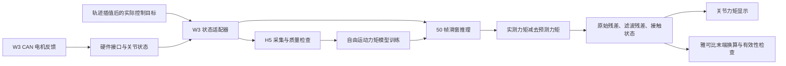

# FACTR2 / W3 外力估计代码与文献审查

审查日期：2026-10-21（Asia/Shanghai）。范围为 `/home/venom/dual_arm_robot`、`/home/venom/factr2` 的仓库结构及控制、采集、训练、推理、末端换算关键路径，包括原有未提交改动。核对了 FACTR2 v1 全文 22 页、附录 A–D，以及上游 `factr2_next` 的公开代码。这里的“部署模型”指最新留存部署配置和实验记录，未通过实时进程检查确认此刻正在运行的程序。

本次新增本报告、离线复算脚本及 JSON 证据；未修改生产控制、推理代码、模型或配置，未执行机器人运动。版本和测试证据见 [provenance.json](/home/venom/factr2/docs/research/review_20261021/provenance.json)。

**主要判断：空载残差来自自由运动力矩预测误差；末端输出缺失还涉及几何可观测性及单一末端负载假设。二者有关，但必须分开诊断。当前最优先事项是稳定底层信号/跟踪，并在新反馈通路下重新验证模型；仅增大奇异阈值、加强低通或切换三维模式，缺乏本机证据支持。**

## 1. 目前代码实现了什么



|模块|已实现的功能|关键源码|
|---|---|---|
|W3 驱动与硬件接口|CAN MIT 协议编解码；关节符号/零点换算；位置、速度、力矩反馈；发送位置、速度、Kp、Kd、前馈力矩|[damiao_protocol.cpp](/home/venom/dual_arm_robot/src/W3_ROBOT/w3_robot_bridge/src/damiao_protocol.cpp:22)、[dm_hardware_interface.cpp](/home/venom/dual_arm_robot/src/ieir_controllers/src/dm_hardware_interface.cpp:586)|
|位置控制|有速度/加速度/jerk 约束的轨迹插值和平滑制动；发布本周期实际下发的 `command_state`，避免把最终目标当作每一帧控制目标|[joint_position_controller.cpp](/home/venom/dual_arm_robot/src/ieir_controllers/src/joint_position_controller.cpp:383)|
|重力/摩擦前馈|Pinocchio 重力计算；逐关节重力系数；按规划速度产生平滑摩擦前馈并限幅、限制变化率|[gravity_compensation_controller.cpp](/home/venom/dual_arm_robot/src/ieir_controllers/src/gravity_compensation_controller.cpp:451)|
|状态适配|左右臂七关节排序、有限值、时间戳、健康检查；发布位置、速度、目标位置、实测力矩四路输入|[adapter_node.py](/home/venom/factr2/factr2_w3_adapter/factr2_w3_adapter/adapter_node.py:15)、[validation.py](/home/venom/factr2/factr2_w3_adapter/factr2_w3_adapter/validation.py:190)|
|采集/数据审计|H5、会话元信息、控制参数与标定快照；时间连续性和覆盖率检查；单关节、联动、静止、换向等采集协议|[recorder_node.py](/home/venom/factr2/factr2_next/src/factr2_next/factr2_next/data_collection/recorder_node.py)、[coverage_audit.py](/home/venom/factr2/factr2_next/src/factr2_next/factr2_next/training/coverage_audit.py)|
|NEXT 训练|整会话/episode 管理；只用训练集拟合归一化；验证集选择最佳模型；物理单位 MSE、早停、梯度裁剪、模型哈希|[dataset.py](/home/venom/factr2/factr2_next/src/factr2_next/factr2_next/training/dataset.py:86)、[w3_train.py](/home/venom/factr2/factr2_next/src/factr2_next/factr2_next/training/w3_train.py:33)|
|NEXT 推理|完整历史窗、异常/断流清空；输出预测自由力矩、原始/滤波外力矩、残差平方均值、接触标量和迟滞接触状态|[inference_node.py](/home/venom/factr2/factr2_next/src/factr2_next/factr2_next/inference/inference_node.py:258)|
|末端估计|URDF 雅可比、量纲缩放、SVD 阻尼最小二乘；条件数和力矩拟合残差检查；工具坐标系旋转；单独网页|[endpoint_wrench.py](/home/venom/factr2/factr2_next/src/factr2_next/factr2_next/inference/endpoint_wrench.py:32)、[w3_endpoint_wrench.py](/home/venom/factr2/scripts/w3_endpoint_wrench.py:171)|
|扩展实验|加入长时运动记忆 MD 的独立模型和观测通路，及反馈时序、惯性、摩擦诊断工具|[motion_discriminator.py](/home/venom/factr2/factr2_next/src/factr2_next/factr2_next/training/motion_discriminator.py:25)、[md_observer.py](/home/venom/factr2/factr2_next/src/factr2_next/factr2_next/inference/md_observer.py)|

当前核心输入/输出是：

\[
x_t=[q_t,\dot q_t,q_{cmd,t}-q_t]\in\mathbb R^{21},\qquad
\hat\tau_f=f_\theta(x_{t-49:t})\in\mathbb R^7,
\]
\[
\hat\tau_{ext}=\tau_{measured}-\hat\tau_f.
\]

50 帧、100 Hz 对应约 0.5 秒历史。标签是窗口最后一帧实测力矩，不是未来力矩。LSTM 每个窗口重新初始化隐状态：这不是实现疏漏。本地 `models.py` 与本次获取的上游提交 `0df02c5b26e33911078152b6c587d6e8a160d279` 逐字一致；模型为两层 128 单元 LSTM、256 隐藏宽度回归头。[上游模型源码](https://github.com/philiphan0109/factr2_next/blob/0df02c5b26e33911078152b6c587d6e8a160d279/src/factr2_next/factr2_next/training/models.py)

W3 输入直接采用驱动解码后的 `effort`，软件按 Nm 使用；并非在 NEXT 内再对裸电流乘一次 K。其绝对物理标度仍取决于电机固件、量程及减速传动定义是否正确，不能用消息字段名证明已经标定。

仓库的主要完成范围是 **NEXT 力矩估计及 W3 工程适配**。没有在当前审查路径发现完整 FIRST 的示范分段重采样、视觉行为克隆训练和任务策略评估实现。`contact_state` 开关和 NEXT 的 `train.py` 不等于 FIRST 策略训练；上游公开仓库的定位同样主要是 NEXT 和可选遥操作示例。[上游 README](https://github.com/philiphan0109/factr2_next/blob/0df02c5b26e33911078152b6c587d6e8a160d279/README.md)

## 2. 空载为什么仍有非零输出

“空载无接触”指环境接触外力矩为零，不代表电机力矩为零。电机仍需克服重力、惯性、摩擦及传动效应。按照当前残差定义，自由运动时有：

\[
\hat\tau_{ext}=\underbrace{\tau_f-\hat\tau_f}_{\text{自由运动预测误差}}+\underbrace{\epsilon_{measurement}}_{\text{测量/标度误差}}.
\]

所以非零残差既可能包含真实接触，也可能只包含建模误差。下列结论按本机证据强弱排列。

**A. 新反馈通路配旧模型，已存在需要重新验证的分布变化。**

10 月 16 日候选模型的训练早于 10 月 19 日反馈消费修复。当前硬件源码已有 `KeepLast(1)`、重复/过旧源帧拒绝和源时间反馈输出。留存实验中，桥接状态到关节状态的最大位置差由 1.07097° 降为 0.02186°，但同一旧模型的空载误差没有同步下降。正式运动残差向量 RMS 的单程均值由 0.23163 增为 0.31354 Nm。两次实验跨日期、温度与实际姿态并非完全一致，不能把误差变化单独归因于反馈修复。[反馈对照原始指标](/home/venom/factr2/log/next_feedback_trial_20261019_v1/comparison.json)

这说明“继续把旧队列问题列为尚未修复的主因”已经过时；也不能认为修复软件时序后旧模型自动继续有效。

**B. 候选模型的验证范围不足，且代码已明确标记未验收。**

最新留存候选为 `targeted_candidate_20261016`，最佳 epoch 12；`deployment_ready=false`。验证/测试是事后按完整采集会话拆分，只有 6°/s 条件，尚缺前瞻独立多速度、冷热机及接触—卸载测试。覆盖审计仍报告联动比例、快速窗口、实测双向速度/时长不足。已有整会话拆分，不能误说仍在随机拆分重叠窗口。[模型元信息](/home/venom/factr2/models/w3/right/targeted_candidate_20261016/metadata.json)、[覆盖审计](/home/venom/factr2/data/right/targeted_training_20261016_v1/production_coverage_audit.json)

这限制了泛化证据，不能据此断言所有低速偏差都由高速数据缺失引起。相反，目前低速启停/阻滞问题值得优先处理。

**C. 底层低速阻滞有直接记录支持，但成因尚未唯一识别。**

10 月 20 日留存分析显示：J4 以 +0.6°/s 规划运动时，位置曾保持同一码 0.983 秒，其间目标已变化 0.590°，约 27 个位置码；另一次现场记录为 1.546 秒、0.927°、约 42 个码。前馈基本恒定，实测力矩随位置误差积累。单纯位置量化不足以解释这些停滞；静摩擦、齿槽、机械阻滞或电机内部死区仍需区分。[摩擦/跟踪诊断](/home/venom/factr2/docs/operator_guide/FRICTION_TRACKING_DIAGNOSIS_20261020.md)

软件并非没有执行摩擦补偿。当前平滑分支是规划速度驱动的 `tanh` 库仑项加黏性项，规划速度归零后前馈逐渐归零；这不等于已经识别装机后的静摩擦。当前运行分支也没有把文件中的 `static_pos/static_neg` 用作起动力矩。另有 J1/J2 重力增益 1.15 与位置伺服相互抵消的证据；URDF 重力仍非独立真值，不宜直接把增益改成 1.0。[控制源码](/home/venom/dual_arm_robot/src/ieir_controllers/src/gravity_compensation_controller.cpp:470)

**D. 速度码的定义与低速分辨率需要核实。**

驱动采用 12 位速度码。已有重建显示 J1/J2 的一个速度码约 1.259°/s，静止反馈接近半码；0.6 与 1.2°/s 的部分命令会落入相同速度码。这是软件编码/记录层证据，不能推出电机内部真实零速度有同等偏置。也不能只修改主机量程以“提高分辨率”，必须与固件一致。[协议实现](/home/venom/dual_arm_robot/src/W3_ROBOT/w3_robot_bridge/src/damiao_protocol.cpp:22)

**E. 低通和接触开关不会消除模型偏置。**

当前配置是 EMA `alpha=0.2`；`cutoff_hz=5` 在 `mode=ema` 下不参与滤波系数计算。EMA 的直流增益为 1，因此稳定偏差最终仍原样保留；100 Hz 下低频群延迟约 40 ms。接触开关采用七关节滤波残差绝对值之和，低/高阈值为 1/2，`scale=1`；它不是概率，也不是每关节方差归一化。[滤波与迟滞实现](/home/venom/factr2/factr2_next/src/factr2_next/factr2_next/inference/inference_node.py:44)、[部署配置](/home/venom/factr2/config/w3/right/inference_targeted_20261016.yaml)

本次复算的两批正式运动记录中，接触开关全部为 0。因此这里确认的是“空载数值不为零”，并没有观察到这些样本中的二值接触误报警。其他时段是否报警，需要对应日志确认。

## 3. 奇异点与末端输出缺失的实际机制

关节外力矩估计本身没有雅可比逆。末端模块额外假设所有外载荷均可等效作用于 `right_attachment_point`，求解：

\[
\tau_{ext}\approx J(q)^T w,\quad
w=[F_x,F_y,F_z,M_x,M_y,M_z]^T.
\]

这也是七关节残差不一定能转成六维末端载荷的原因：一般七维向量未必处于 `Jᵀ` 的六维列空间。分布于多个连杆的接触、关节摩擦误差、模型偏差均可能破坏该假设。反过来，残差能拟合某个末端载荷，也不证明发生了真实末端接触。

当前实现已用特征长度 0.4 m 平衡平移/旋转量纲，并作 SVD 阻尼求解，`damping=0.005`。拒绝逻辑是：

1. 缩放后的条件数超过 100 或秩退化：`near_singular`，在阻尼求解前返回。
2. 求解后的 `||Jᵀw−τ|| / max(||τ||, 0.1 Nm) > 0.35`：`inconsistent_with_tool_contact`。
3. ROS 节点另检查超时、训练包络和上游状态。

因此“加阻尼”已不是从零开始的新方案；只加大阻尼也不会越过先执行的条件数门禁。零附近第二条等价于允许最多约 0.035 Nm 的绝对拟合误差，尚未按本机逐关节误差协方差标定。[求解器具体位置](/home/venom/factr2/factr2_next/src/factr2_next/factr2_next/inference/endpoint_wrench.py:43)

本次用已保存的 q、原始/滤波残差和捕获 URDF，重新调用现有求解器；未训练、扣零或调整门限。六维滤波模式的通过/拒绝数与原日志完全一致：

|运动数据段|帧数|六维条件数范围|六维通过率|奇异拒绝|不一致拒绝|三维点力通过率|
|---|---:|---:|---:|---:|---:|---:|
|10 月 15 日随机运动|4,734|10.38–14.97|69.88%|0|1,426|18.17%|
|10 月 19 日正式运动|11,900|11.19–12.85|69.54%|0|3,625|24.93%|

三维模式的几何条件数更好，但其“工具原点外加力矩为零”假设更严格，反而拒绝更多残差。它适用于确知为该点纯力、没有未知力偶的任务；偏心施力即使只有一个实际接触点，也可能相对工具原点产生力矩。不能将其作为无条件减少丢帧的开关。

10 月 19 日所有正式运动帧的原始残差逐关节平均 MAE 为 0.07476 Nm；六维有效帧的力范数 P95 为 5.5169 N。原始残差换算通过率为 70.23%，滤波后为 69.54%，去掉 EMA 在此批数据中只改善 0.69 个百分点，不能解决主体问题。有效帧统计不能代替全帧精度；模型、运动不同的日期之间也不能直接归因比较。

数据和代码见 [endpoint_replay.json](/home/venom/factr2/docs/research/review_20261021/endpoint_replay.json)、[analyze_endpoint.py](/home/venom/factr2/docs/research/review_20261021/analyze_endpoint.py)。这里没有否定其他姿态发生奇异的可能性；实际 URDF 零姿态确会被现有几何测试拒绝。

## 4. 作者是否遇到相同问题，以及怎样处理

FACTR2 明确把自由运动预测误差作为问题：残差混有摩擦、迟滞、温度及驱动效应。作者用包含位置、速度、跟踪误差的滑窗 LSTM，并采集单关节、联动、慢/快自由运动。其空载结果仍非零：Franka 平均关节 L1 误差为 **0.414±0.278 Nm**，Piper 为 **0.018±0.012 Nm**。这是不同平台的实验结果，不是 W3 验收阈值。论文还指出力矩绝对标度依赖 K，跨机械臂可能需要重训。[FACTR2 §3–4、§6.1、§9、附录 A](https://arxiv.org/html/2606.12406v1)

通读正文和附录后，未发现作者报告或专门解决“雅可比奇异导致 NEXT 无法估计”的证据。其估计、力反馈和策略输入围绕关节外力矩展开。FIRST 使用接触阶段重采样改善策略学习；它不能直接修复力矩预测误差或六维不可观测性。[FACTR2 §5、§6.1](https://arxiv.org/html/2606.12406v1#S5)

还需区分论文与后来公开的示例代码：上游 README 明确说可选遥操作示例中的接触门控、斜坡及新鲜度保护未用于 FACTR2 论文实验，不能把这些工程保护描述成论文解决空载误差的算法。[上游说明](https://github.com/philiphan0109/factr2_next/blob/0df02c5b26e33911078152b6c587d6e8a160d279/README.md#optional-factr2-feedback-demo)

同作者的前作 FACTR 提供了更直接的摩擦控制参考：leader arm 使用小幅高频振荡帮助克服静摩擦，加上库仑/黏性摩擦补偿；还用零空间投影调节冗余姿态。这是主手控制方案，不能据此声称已解决 W3 从臂的无传感力估计或所有奇异问题。[FACTR §III-B、附录 IX-A](https://arxiv.org/html/2502.17432v1#A9.SS1)

## 5. 相关研究及对本项目的适用性

下面区分 FACTR2 直接引用的工作与补充相关工作。每一行的“本项目建议”是本次分析，不是原论文对 W3 的实验结论。

|研究与关系|论文怎样处理|本项目建议与边界|
|---|---|---|
|Linderoth 等，IROS 2013；FACTR2 参考文献 [39]。[原文入口](https://portal.research.lu.se/en/publications/robotic-force-estimation-using-motor-torques-and-modeling-of-low-/)|将低速摩擦视为速度相关的不确定区间，加测量噪声；融合多个关节，通过凸优化求末端力并计算近似置信区间；用独立力传感器验证。|最贴近当前的“低速残差+末端换算”问题。建议学习自由运动残差的不确定性，再做加权估计和可信度判断。该文慢速假设忽略动力学项，不能照搬至快速运动。|
|Mamedov & Mikhel，Frontiers 2020；FACTR2 [43]。[全文](https://www.frontiersin.org/journals/robotics-and-ai/articles/10.3389/frobt.2020.571574/full)|在 UR10e 比较辨识、观测器和碰撞阈值，强调模型辨识的重要性；按自由运动残差设阈值，比较快/慢观测器。其带通实验未普遍改善误报。|把“连续力估计”和“事件检测”分开评估。门限来自独立校准数据，并报告误报与漏检；不能靠高通把持续接触滤掉来获得漂亮零线。|
|Shan & Pham，ICRA 2024；补充相关工作。[全文](https://arxiv.org/html/2309.16219v2)|针对停止后的静态迟滞，MD 保留越过速度阈值的历史，配合分层残差网络和启停丰富数据；导纳实验仍需死区。末端映射另用带外部力测量训练的网络。|比单纯加长 0.5 秒窗口更有针对性，但本机已经做过 NEXT+MD 特征消融且变差，不能再将“加 MD”当作未经尝试的现成答案；完整 HRDL-MD 与本机拼接消融不同。|
|Iskandar & Wolf，ICRA 2019；补充相关工作。[DLR 原文](https://elib.dlr.de/128180/)|将温度、速度、负载依赖纳入摩擦模型，并可接入 LuGre/GMS；在谐波减速器试验台验证补偿及外力矩估计。|先做匹配姿态/路径的冷热机实验，确认温度关系后再加入温度或热状态特征。试验台结论不构成整臂精度保证。|
|Scholl 等，RCIM 2024；补充相关工作。[DLR 原文及勘误入口](https://elib.dlr.de/204073/)|保留基础摩擦模型，另用小网络学习新工况下的残差，以适应非对称等动力学变化。|可以考虑冻结 NEXT 后的离线残差适配分支；需明确无接触训练数据和独立接触验证。当前 W3 残差未分解成纯摩擦，不能直接称为摩擦真值。|
|Sagli 等，MIC 1993；奇异处理的数值方法参考。[论文](https://www.mic-journal.no/ABS/MIC-1993-2-5/)|用加权阻尼最小二乘处理冗余逆运动学，根据最小奇异值选阻尼，在七关节模型中仿真。|可以借鉴自适应阻尼与姿态优化；原文是逆运动学研究，并非无传感力估计实验。数值正则化不会创造丢失的力观测信息。|

本机 MD 消融：原版 NEXT 与 NEXT+MD 的测试 MSE 分别约为 0.0066566、0.0246266 Nm²，后者约为前者 3.70 倍；已有共同有效帧比较也没有显示改善。应保留为负结果，而不是依据论文的正结果覆盖本机结果。[本机消融报告](/home/venom/factr2/docs/operator_guide/NEXT_MD_ABLATION_20261016.md)

## 6. 建议的修改与验证顺序

**第一步：把测量问题、模型问题和显示问题分别留证。**

保留原始残差、滤波残差、接触开关和末端状态；单独统计 `near_singular`、`inconsistent_with_tool_contact`、`out_of_scope` 和 `stale`，不能合并为“外力检测失败”。记录最小奇异值、条件数、每关节残差，以及返回姿态的实测位置而非仅指令位置。

训练、录制、部署应统一使用可解释的源时间。新 `feedback_state` 已存在，但默认 adapter 仍接 `/joint_states`；`validation.py` 是取最新 state/command、允许 30 ms 源偏差后统一输出 state 时间戳，不是对原始采样时刻做插值。建议用原始源时间关联此前有效的控制命令，并保存两路原时间戳。10 月 19 日记录中实际源偏差 P95 为 0、最大约 3.36 ms，故 30 ms 是设计容忍上限，不是已测到 30 ms 延迟；不能据它武断解释当前误差。[适配代码](/home/venom/factr2/factr2_w3_adapter/factr2_w3_adapter/validation.py:204)、[时间统计](/home/venom/factr2/log/next_feedback_trial_20261019_v1/feedback_analysis.json)

**第二步：先固定低速跟踪、固件量程、前馈配置，再采新的训练/验收集。**

优先核查 J4 阻滞、零速码定义、J1/J2 重力与 J6 摩擦系数。通过实际位置匹配的双向到位、停留、单关节和联动实验区分影响。重复采集不应只是增加同一路径的帧数，而应覆盖姿态、实测速度、加减速、换向、停止前历史、长停留及冷热状态。控制增益、前馈、工具和信号时序发生改变后，模型也需重新验证。

已有看过的日志属于诊断证据，不再称作全新盲测。新训练集、验证集和最终验收应预先按采集会话划分。空载指标至少包括逐关节有符号偏差、MAE/RMSE、绝对误差 P95/P99、迟滞接触误报和运动后恢复时间。

**第三步：先重训/对照原版，再讨论扩展输入。**

当前结构与上游一致，没有理由仅凭非零输出先换更大网络。若新数据仍显示控制相关误差，再比较加入 `qdot_cmd`、温度或摩擦状态等扩展，并保持共同数据、共同选模规则和独立验收。不要直接把实测力矩作为自由力矩预测输入，否则易形成目标泄漏。由于跟踪误差会随接触改变，任何减小空载误差的模型都要验证是否同时削弱真实接触灵敏度；空载预测优秀不能证明接触估计正确。

**第四步：用误差统计改善末端求解，而不是任意放宽门限。**

当前求解相当于各关节同权。可从独立无接触校准集得到状态相关残差均值 b 和协方差 R，构建：

\[
\hat s=\arg\min_s(A s-(\hat\tau_{ext}-b))^T R^{-1}(A s-(\hat\tau_{ext}-b))
+\lambda^2\|s-s_0\|^2,
\]

其中 `s=[L F; M]`、`A=[Jv/L; Jω]ᵀ`，维持与现实现一致的量纲缩放。这是可试验的工程扩展，不是已验证修复。均值/协方差要在训练或专用校准数据上确定并冻结；不能在未知接触中持续“自动清零”，否则会把持续接触当成偏置吸收。

一致性门禁可以改为有绝对误差尺度、协方差权重和明确误报目标的检验。不要只输出一个 `valid`：可分别给出关节力矩、末端拟合程度和每个可观测方向的不确定性。条件数只是相对指标，绝对最小奇异值和噪声到力的放大率也应参与判定。

**第五步：若另一些工作姿态确实奇异，再做几何处理。**

- 保留关节外力矩输出及其自身有效性；末端不可用不应阻断关节层观察。
- 只需纯点力且接触位置明确时，才用现有 `force_only`；有偏心力矩或旋拧任务应保留六维估计。
- 通过七自由度冗余调姿，提高任务路径的最小奇异值，并在限位、碰撞和训练包络内选择姿态。现有 `ik_position()` 是位置任务的阻尼 IK，没有显式六维力可观测性优化目标；已有部分采集协议的条件数检查可复用，但不能认为所有运行路径都已避奇异。
- 可试验按奇异值自适应阻尼或截断 SVD，仅报告可靠的力方向组合；丢失方向要标为未观测，不能用零或上一帧数值冒充测量。尤其不能宣称伪逆能在真正秩亏时恢复任意六维外力。

**最终验收需包含受控真实接触与卸载。** 使用已知加载方向/位置及独立参考力，验证符号、幅值、延迟、最小可检测力和卸载恢复；已知砝码仅能覆盖部分静态方向，不能替代动态六维验证。验收标准由任务所需力分辨率和允许误报率决定，不能把残差滤成零作为通过条件。

## 7. 本次验证及可复算内容

本次执行 55 项离线测试，覆盖训练契约、完整历史窗、滤波/迟滞、训练包络、实际 URDF 雅可比有限差分与虚功、已知载荷恢复、奇异拒绝和末端不一致拒绝，全部通过。它们支持核心数学和代码行为的正确性，不构成真实力精度验收。

新增复算只读取已保存实验数据，不初始化 ROS、不发布命令：

```bash
cd /home/venom/factr2
env PYTHONDONTWRITEBYTECODE=1 OPENBLAS_NUM_THREADS=1 OMP_NUM_THREADS=1 \
  .venv/bin/python docs/research/review_20261021/analyze_endpoint.py
```

输出 [endpoint_replay.json](/home/venom/factr2/docs/research/review_20261021/endpoint_replay.json) 包含输入文件 SHA256、两种估计模式、原始/滤波信号、全部拒绝计数和有效帧统计。测试命令与源码版本记录在 [provenance.json](/home/venom/factr2/docs/research/review_20261021/provenance.json)。
