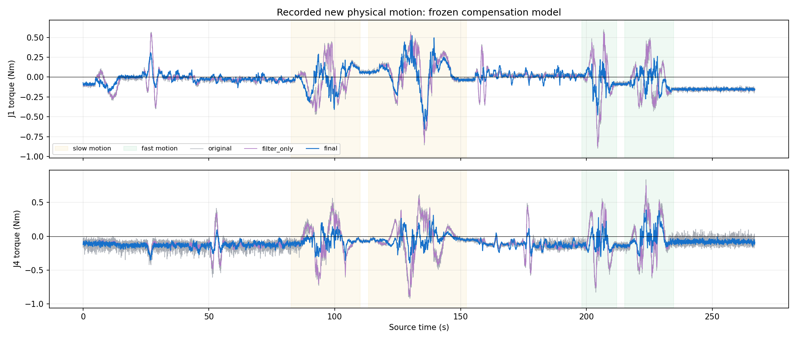
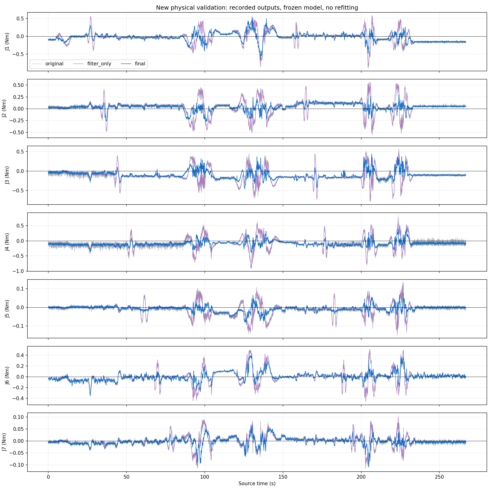
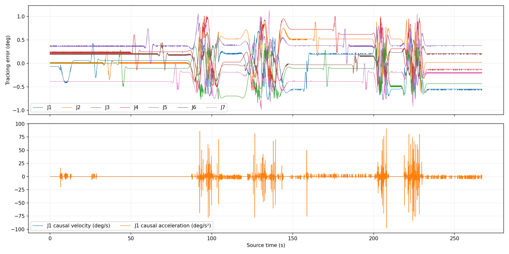

# 补偿模型冻结后的新实机运动验证

状态：completed，完成 26/26 段。

新记录 26693 帧、266.91 秒，平均 100.00Hz，最大源间隔 13.39ms。

本次记录来自部署后的新实机运动。模型、滤波与增益冻结，没有用本次数据重训练或选参数。原始输入与结果保留完整精度；窗口两位小数仅用于显示。空载为现场声明，没有独立外力矩真值。

图中蓝线为实际发布到8083的最终输出，灰线为原NEXT残差，紫线为同滤波参数但关闭学习补偿的离线对照。运动统计只含完成的连续运动块，不混入试走或静止停留；另列中间60%激励段和两档速度。

全程最大跟踪误差 1.132°；原始/补偿力矩恒等式误差 4.44e-16N·m。新实机输出与冻结模型回放最大差异 1.2477865962701173e-12N·m。

## motion：9964 帧，补偿支持率 100.00%

|关节|原始RMS N·m|仅滤波RMS|最终RMS|相对原始改善|最终绝对P95|最终绝对峰值|
|---|---:|---:|---:|---:|---:|---:|
|J1|0.23411|0.23256|0.16196|30.8%|0.32395|0.65412|
|J2|0.22489|0.22339|0.08467|62.4%|0.19371|0.29962|
|J3|0.25946|0.25698|0.15869|38.8%|0.26244|0.46527|
|J4|0.25789|0.25509|0.12158|52.9%|0.23928|0.39401|
|J5|0.04769|0.04698|0.02557|46.4%|0.05036|0.08293|
|J6|0.18037|0.17961|0.11181|38.0%|0.25226|0.39293|
|J7|0.03482|0.03436|0.02404|30.9%|0.04920|0.10669|

## slow：6635 帧，补偿支持率 100.00%

|关节|原始RMS N·m|仅滤波RMS|最终RMS|相对原始改善|最终绝对P95|最终绝对峰值|
|---|---:|---:|---:|---:|---:|---:|
|J1|0.22324|0.22193|0.17681|20.8%|0.36683|0.65412|
|J2|0.20882|0.20754|0.08838|57.7%|0.20084|0.27949|
|J3|0.24698|0.24481|0.15715|36.4%|0.25833|0.46527|
|J4|0.24244|0.23997|0.10911|55.0%|0.22660|0.39401|
|J5|0.04770|0.04707|0.02742|42.5%|0.05467|0.08293|
|J6|0.17332|0.17272|0.11430|34.1%|0.25059|0.39293|
|J7|0.03371|0.03331|0.02544|24.5%|0.04926|0.09349|

## fast：3329 帧，补偿支持率 100.00%

|关节|原始RMS N·m|仅滤波RMS|最终RMS|相对原始改善|最终绝对P95|最终绝对峰值|
|---|---:|---:|---:|---:|---:|---:|
|J1|0.25439|0.25242|0.12729|50.0%|0.24731|0.47804|
|J2|0.25391|0.25201|0.07674|69.8%|0.16110|0.29962|
|J3|0.28268|0.27966|0.16172|42.8%|0.27391|0.43712|
|J4|0.28620|0.28284|0.14323|50.0%|0.26327|0.38941|
|J5|0.04767|0.04678|0.02139|55.1%|0.04356|0.07574|
|J6|0.19365|0.19261|0.10666|44.9%|0.25610|0.37473|
|J7|0.03694|0.03638|0.02098|43.2%|0.04765|0.10669|

## motion_core：5978 帧，补偿支持率 100.00%

|关节|原始RMS N·m|仅滤波RMS|最终RMS|相对原始改善|最终绝对P95|最终绝对峰值|
|---|---:|---:|---:|---:|---:|---:|
|J1|0.29008|0.28814|0.19460|32.9%|0.39345|0.65412|
|J2|0.28394|0.28217|0.10012|64.7%|0.20736|0.29962|
|J3|0.29311|0.28996|0.14934|49.1%|0.29117|0.46527|
|J4|0.31716|0.31376|0.13625|57.0%|0.26927|0.39401|
|J5|0.05811|0.05726|0.02726|53.1%|0.05793|0.08293|
|J6|0.22692|0.22596|0.13654|39.8%|0.30659|0.39293|
|J7|0.04347|0.04293|0.02960|31.9%|0.05739|0.10669|

## 静止偏置与限制

before_last5 最后5秒最终平均偏置 N·m：J1=0.0025, J2=0.0402, J3=-0.0605, J4=-0.1341, J5=0.0029, J6=-0.0777, J7=-0.0113。

after_last5 最后5秒最终平均偏置 N·m：J1=-0.1532, J2=0.0503, J3=-0.1043, J4=-0.0787, J5=-0.0011, J6=0.0076, J7=-0.0047。

小RMS不等于已标定的外力精度；静止偏置、姿态和温度误差可能仍存在。本次速度与姿态范围接近采集数据，不证明跨姿态/更高速度泛化，也没有验证真实接触。补偿没有截距、在线学习或自动归零；输入/输出滤波会延迟和削弱短脉冲。

模型 SHA256：89af2ae40f122e512287dac6fe0798d388701ad10c43cdfcaaa50a5888fc459e

原始H5、bag、CAN与参数快照：/home/venom/factr2/data/quick_capture/right/20261025_154916_281304

## 本次观察结论

七关节正式运动段RMS下降约30.8%～62.4%，仅滤波约0.4%～1.5%；相邻样本差分RMS下降57.4%～83.1%。后者表示曲线粗糙度降低，不是独立噪声真值或接触测量精度。

较快档RMS下降约43%～70%（J3为42.8%）；低速档约21%～58%。补偿支持率100%，原NEXT和新补偿观察器的丢弃、重置增量均为0。

停止后的J1最终平均残差约−0.153N·m，J3约−0.104N·m，J4约−0.079N·m，说明速度/加速度补偿未清除静止偏置。

前后静止指令差最大 0.00000000°，但实测姿态存在差异，最大为J1的 0.613°；各轴差值为 -0.613°, 0.008°, -0.437°, -0.353°, 0.020°, 0.007°, 0.190°。不能将残差变化单独归因于温漂或摩擦；实测位置跟踪差异、姿态对应的模型误差和反馈偏差尚未分离。

本次只记录与分析，未重训练、未改补偿参数，也未通过自动调零使残差消失。单次相近工况的新实机验证不代替更广姿态和真实接触验证。

[运动时窗口原始截图](window_during_motion.png)

停止后8秒观察，关节位置最大变化约0.022°；只读复核控制器与健康状态通过。机械臂保持工作中心指令，本次未发送后续运动。
