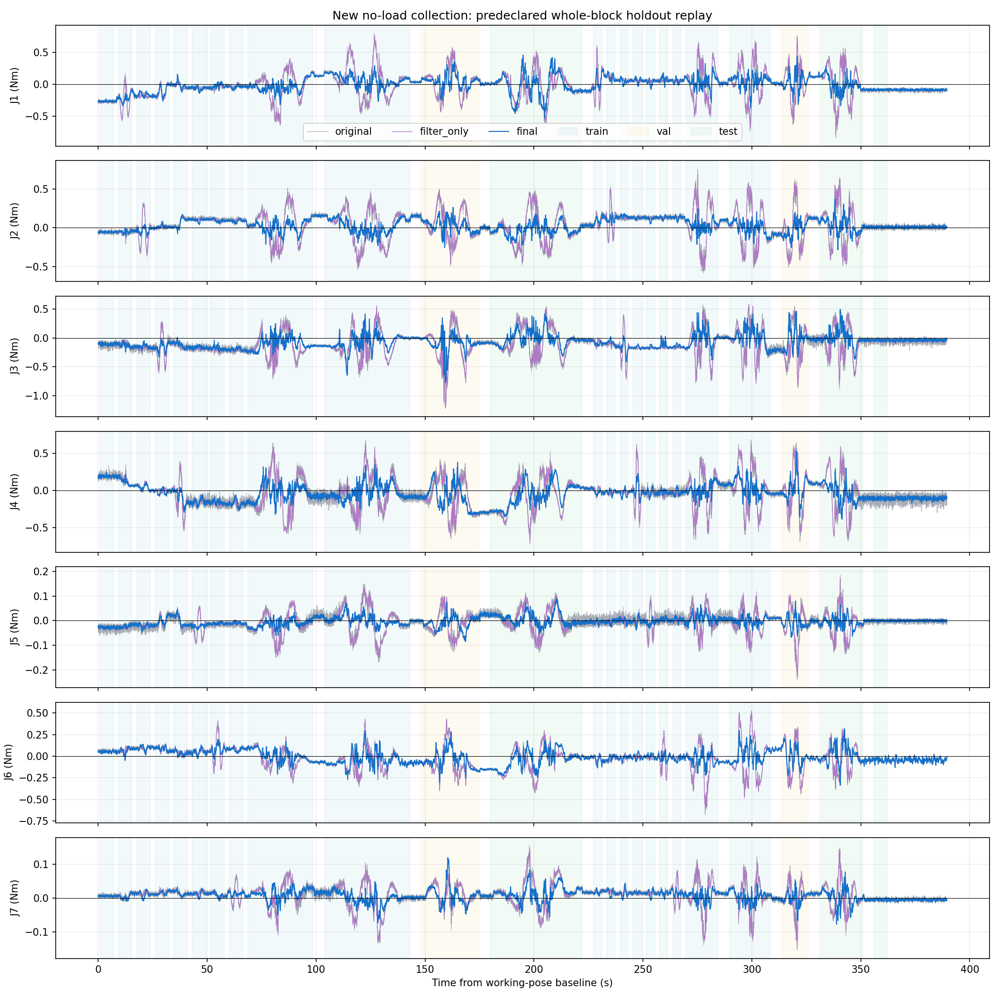
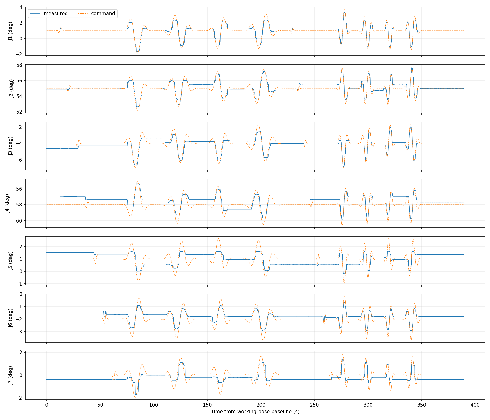

# 新采空载数据：速度与加速度补偿

本次右臂执行新采集轨迹，模型拟合使用原始 ROS 精度，不使用窗口四舍五入值。空载由现场人员确认；无独立外力矩传感器，以下衡量空载残差，不能当作已标定的接触测量精度。

训练、验证、测试角色在采集前按完整运动块冻结；每段首尾各排除 1 秒。只用训练段拟合、验证段选择模型与启用关节，测试结果未参与参数选择。历史记录级划分保持不变，已查看过的历史测试仅作回顾性比较。

选中：velocity_acceleration，local_pose，ridge=0.1；启用 J1, J2, J3, J4, J5, J6, J7。未通过验证的关节只滤波，补偿不增加常数截距、不输入力矩残差、不在线调零。

新测试运动段 6172 帧，处于补偿支持范围的比例 100.00%。

|关节|原始 RMS N·m|仅滤波|仅速度＋滤波|速度加速度＋滤波|选中输出|相对原始改善|
|---|---:|---:|---:|---:|---:|---:|
|J1|0.23911|0.23746|0.17991|0.17361|0.17361|27.4%|
|J2|0.23251|0.23099|0.08666|0.08800|0.08800|62.2%|
|J3|0.25289|0.24970|0.13360|0.12987|0.12987|48.6%|
|J4|0.25389|0.25180|0.16702|0.16127|0.16127|36.5%|
|J5|0.05156|0.05047|0.02385|0.02423|0.02423|53.0%|
|J6|0.14699|0.14611|0.10569|0.10776|0.10776|26.7%|
|J7|0.04431|0.04390|0.02690|0.02563|0.02563|42.2%|

加速度相对仅速度的额外收益有限；本次测试 J2, J5, J6 的速度＋加速度结果略差于仅速度。模型仍按验证集选择，未用测试结果重新挑选关节参数。

分档统计中，低速 J1 的 RMS 改善仅 4.2%，不能用整体平均掩盖这一点。静止测试 J1 最终 RMS 0.08719 N·m，J4 为 0.10666 N·m；速度/加速度补偿不能保证清除静止偏置。

负改善表示变差，不应通过抹平或自动归零隐藏。以上是同次采集中留出的新运动块，仍不能证明不同姿态、温度、速度或真实接触时的泛化。

补偿形式为 H5[H12(实测力矩)−H12(NEXT 自由预测)−c(因果速度、加速度与方向特征)]。实际位置与指令位置经常加速度卡尔曼滤波得到运动学量，保留输入/输出滤波既有配置。超出训练支持范围时补偿回退为零，保留残差；新姿态需要补充数据。

固定运动学的 0.3 N·m 合成阶跃稳态增益 1.000000，90% 响应约 80 ms。这是信号链测试，未代替实机接触实验；新输出不用于安全联锁或力控。

完整的偏置、峰值、运动/静止分项、两档速度分项及速度/加速度相关系数见 heldout_detail.json。

采集记录：/home/venom/factr2/log/kinematic_collection_20261025_v1
冻结轨迹 SHA256：5546a8ebea78441d66a67acf618bd53ebd2693541244b2620aa4bc45df64802d
