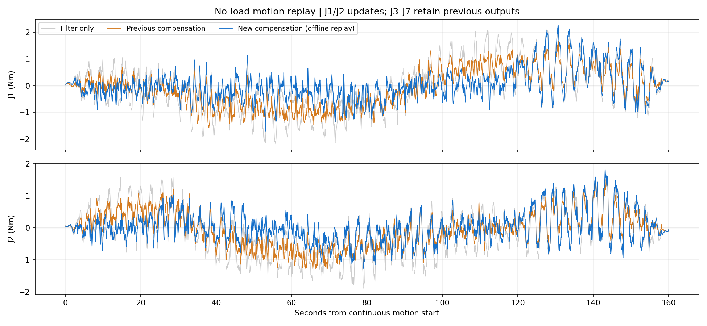
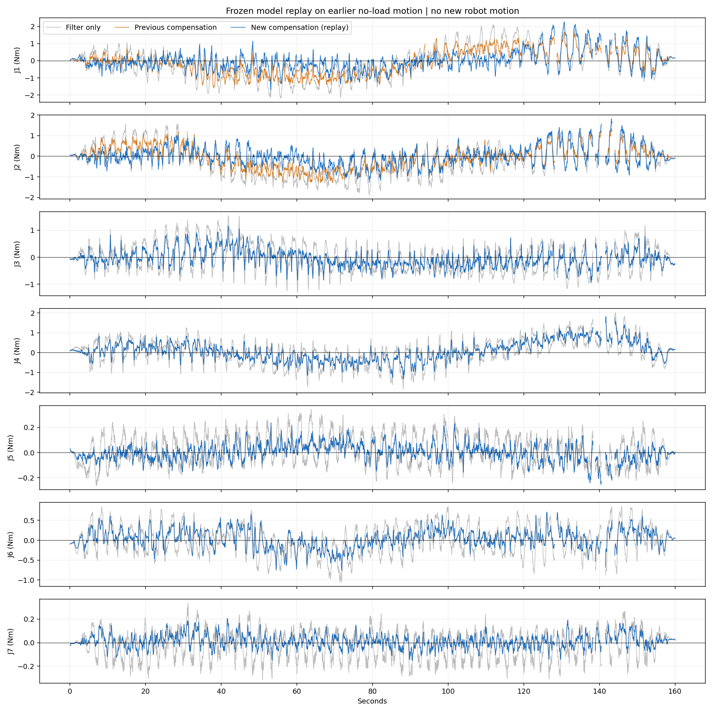

# 空载外力矩补偿改进（2026-10-27）

代码、冻结模型和默认检测配置已更新；本次未启动机器人驱动、使能电机或发送运动命令。当前主机的机器人驱动、适配器及检测服务均未运行，尚未完成新模型的实机运动复测。自动校时服务已经处于运行状态，本次未修改。

七个关节继续启用补偿。验证集选择J1/J2使用新非线性分支，J3–J7保留原补偿。逐轴要求低速和高速验证MSE分别不高于原补偿105%，且等权归一化分数至少改善2%；选择不使用回放记录。新增姿态项、姿态/速度/加速度耦合特征，以及单种子、30轮上限的小型140→64→64→7冻结MLP；验证集选择第12轮。连续速度权重只作用于预测补偿量，不压缩外力矩输出。
新分支超出特征适用范围时回退到冻结原补偿；超出两者适用范围时仍按原规则回退、标记。原12Hz输入滤波和5Hz输出滤波、NEXT基模型、补偿限幅不变。没有输出死区、强制归零、在线拟合或实时零偏学习。

## 上一轮实机数据的离线回放

来源为2026-10-26的33,294帧记录；统计正式连续段中间140秒中的13640帧有效样本。它不是新采集的实机波形，也不是未曾观察过的盲测；没有将该记录用于拟合或逐关节参数选择。整体RMS由 0.433278 降为 0.378913 N·m，下降 12.55%。

|关节|仅滤波RMS N·m|原补偿RMS N·m|新补偿回放RMS N·m|
|---|---:|---:|---:|
|J1|0.90284|0.74668|0.58736|
|J2|0.75830|0.57420|0.48286|
|J3|0.52788|0.32912|0.32912|
|J4|0.64128|0.50277|0.50277|
|J5|0.12254|0.06897|0.06897|
|J6|0.37165|0.23987|0.23987|
|J7|0.12701|0.05907|0.05907|

J3–J7逐点最大差 2.94e-13 N·m；原输出得到保留。在线逐帧数学路径与批量回放最大差 3.98e-14 N·m，回放评价段补偿支持率100.00%；整条100Hz逐帧计算P99约0.216ms。

## 原保留数据集评价

|数据|仅滤波RMS N·m|原补偿RMS N·m|新补偿RMS N·m|
|---|---:|---:|---:|
|历史低速|0.077250|0.096298|0.083944|
|历史/新增高速|0.519413|0.390940|0.362633|

两个速度域的总体残差均低于原七轴补偿版本，但历史低速仍比仅滤波基线高。原低速MSE不超过基线115%的门槛仍未通过（未放宽阈值），因此deployment_ready=false，只配置为用户要求的只读研究观察。不要把它称为已解决空载误报或已验证接触精度。测试集在多次研究评价中已经观察过，本轮参数仅以训练/验证集拟合和选择，测试评价不等于全新独立盲测。

## 外力保留与验证

固定同一运动学输入，在反馈力矩上叠加持续0.3N·m的合成阶跃，最终增量保持0.3N·m，稳态增益1.0，90%响应约80ms，与原12Hz+5Hz滤波一致。该试验证明固定运动学条件下不通过自动归零消除持续力矩，不能代替真实接触、接触引起位姿变化或力矩传感器标定。
数值、因果性、模型合同、低速权重、支持域回退、持续力矩保留及记录完整性测试通过；隔离ROS域199验证旧/新模型只读发布和过期保护。详见tests.log与isolated_transport.log。

## 配置与复现

默认配置：/home/venom/factr2/config/w3/right/compensation_active.json
新模型：/home/venom/factr2/data/right/validated_joint_compensation_20261026_v1
检测入口不传--experiment时会读取固定模型哈希的默认配置；显式--experiment仍可选择原补偿对照。check-only只检查文件和合同，不表示检测服务已运行。机器人、适配器和冻结NEXT基础服务需要按原启动流程准备，本次没有自动启动控制端。

```bash
cd /home/venom/factr2
bash scripts/next.sh python scripts/observe_w3_kinematic_compensation.py --check-only
# 在原有机器人数据流和冻结NEXT服务就绪后，再启动只读检测窗口：
export ROS_DOMAIN_ID=74 ROS_LOCALHOST_ONLY=1
export FASTRTPS_DEFAULT_PROFILES_FILE=/home/venom/factr2/config/w3/dds_loopback.xml
bash scripts/next.sh env OPENBLAS_NUM_THREADS=1 OMP_NUM_THREADS=1 MKL_NUM_THREADS=1 python scripts/observe_w3_kinematic_compensation.py
```




