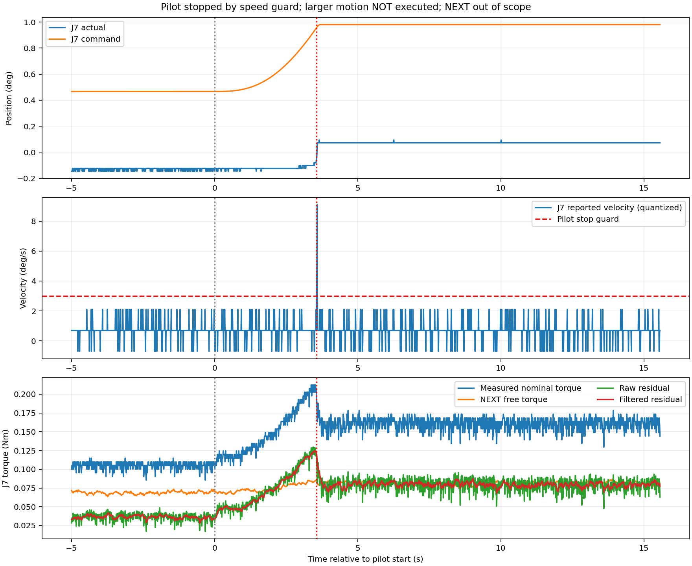

# 较大幅度长时间运动：执行中止记录（2026-10-23）

**未完成较大幅度长时间运动。** 已生成、检查约228.64秒的分段方案，并开始完整采集。第一段J7低速复查再次触发原有3°/s速度反馈保护，已请求有界停止；未进入后续大幅运动，未自动重试或额外回位。

用户已确认空载、全范围清空及急停可用；磁盘由不足50MB恢复到约18GB。

从首段计划开始至bag接收到停止请求约3.568秒，J7报告速度峰值约9.095°/s，非独立物理测速。包括停止后的制动观察，J7相对起始基线的最大位置偏移约0.224°；最后10秒位置跨度约0.02186°，均值相对起始偏移约0.202°。独立3秒只读复核确认位置和重力控制器仍active，双臂健康正常。

完整采集目录：本次会话（原始路径：`data/quick_capture/right/20261023_102413_839440`，见备份清单）。H5为4792行、47.90秒、100.02Hz，数据质量PASS；动作状态failed。被动CAN接收119963帧，无socket丢帧或缺内核接收时间戳记录。温度记录为名义MOS约29–31℃、内部温度约26–28℃，不是独立校准温度。

额外只读记录约108秒，10716个七路完整对齐帧；输出状态包含10715帧out_of_scope及1帧warming，没有valid。当前J2/J4接近零位，超出模型训练姿态。因此以下为模型残差，不能认定为真实环境接触力矩，也不能作为本次大幅动态验证结果。

|关节|实测力矩标准差(Nm)|原始残差均值(Nm)|运动及制动残差绝对峰值(Nm)|最大跟踪误差(°)|
|---|---:|---:|---:|---:|
|J1|0.002705|+2.589730|2.629399|0.0000|
|J2|0.007822|-5.643124|5.658518|0.0000|
|J3|0.040838|-1.239095|1.324349|0.0219|
|J4|0.008753|+2.242881|2.264319|0.0000|
|J5|0.011038|-0.077808|0.103367|0.0219|
|J6|0.006601|+0.298461|0.316994|0.0000|
|J7|0.004680|+0.035558|0.129565|1.0346|

详细噪声及标定研究（原始路径：`docs/research/CURRENT_TORQUE_NOISE_REVIEW_20261023.md`，见备份清单）。完整对齐数据为noise_analysis/aligned_samples.csv；逐阶段统计为noise_analysis/metrics.json；原始四流、完整bag、原始CAN、温度及冻结模型/参数保存在本次会话。未改控制增益、传动参数或在线模型。

