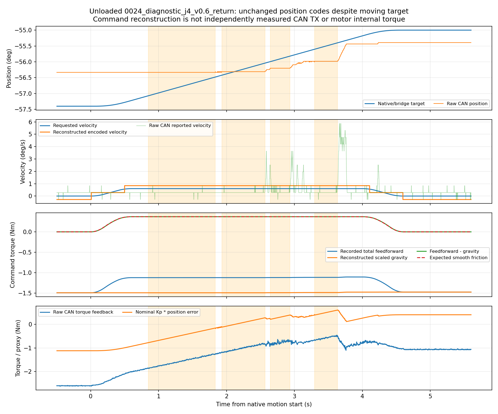

# 摩擦、死区和底层跟踪排查

来源：/home/venom/factr2/log/next_feedback_trial_20261019_v1。只读分析，无新运动、增益调整、模型修改或时延拟合。

## 量化与软件限幅

|关节|速度一个码 (°/s)|位置一个码 (°)|一位置码对应 Kp 力矩 (Nm)|零速半码对应 Kd 力矩量级 (Nm)|
|---|---:|---:|---:|---:|
|J1|1.259|0.02186|0.0267|0.0302|
|J2|1.259|0.02186|0.0267|0.0275|
|J3|0.560|0.02186|0.0267|0.0098|
|J4|0.560|0.02186|0.0229|0.0098|
|J5|1.399|0.02186|0.0038|0.0085|
|J6|1.399|0.02186|0.0134|0.0122|
|J7|1.399|0.02186|0.0038|0.0061|

上表Kd项仅是按软件解码计算的量级，不证明电机内部速度偏置。限幅计数是桥接入口相对配置限幅的计数，不覆盖电机电流/温度限幅。

## 匀速平台核查

|关节/方向|目标速度 (°/s)|同一位置码最长持续 (s)|这段时间目标走过 (°)|相当于位置码数|前馈减重力均值 (Nm)|平滑摩擦理论值 (Nm)|
|---|---:|---:|---:|---:|---:|---:|
|J1 out|0.6|0.371|0.223|10.2|+0.2603|+0.2603|
|J1 return|0.6|0.331|0.199|9.1|-0.2745|-0.2745|
|J2 out|0.6|0.389|0.233|10.7|+0.2603|+0.2603|
|J2 return|0.6|0.649|0.389|17.8|-0.2745|-0.2745|
|J3 out|0.6|0.585|0.351|16.1|-0.3823|-0.3823|
|J3 return|0.6|0.617|0.370|16.9|+0.3802|+0.3802|
|J4 out|0.6|0.517|0.310|14.2|-0.3521|-0.3521|
|J4 return|0.6|0.983|0.590|27.0|+0.3713|+0.3713|
|J5 out|0.6|0.511|0.307|14.0|+0.0584|+0.0584|
|J5 return|0.6|0.397|0.238|10.9|-0.0619|-0.0619|
|J6 out|0.6|0.169|0.101|4.6|-0.2811|-0.2811|
|J6 return|0.6|0.177|0.106|4.9|+0.2811|+0.2811|
|J7 out|0.6|0.469|0.281|12.9|+0.0365|+0.0365|
|J7 return|0.6|0.503|0.302|13.8|-0.0387|-0.0387|
|J1 out|1.2|0.260|0.312|14.3|+0.3234|+0.3234|
|J1 return|1.2|0.257|0.309|14.1|-0.3411|-0.3411|
|J2 out|1.2|0.237|0.285|13.0|+0.3234|+0.3234|
|J2 return|1.2|0.386|0.463|21.2|-0.3411|-0.3411|
|J4 out|1.2|0.500|0.600|27.5|-0.4379|-0.4379|
|J4 return|1.2|0.540|0.648|29.6|+0.4618|+0.4618|
|J1 out|2.4|0.060|0.144|6.6|+0.3333|+0.3333|
|J1 return|2.4|0.111|0.267|12.2|-0.3516|-0.3516|
|J2 out|2.4|0.086|0.206|9.4|+0.3333|+0.3333|
|J2 return|2.4|0.137|0.329|15.1|-0.3516|-0.3516|
|J4 out|2.4|0.129|0.309|14.1|-0.4521|-0.4521|
|J4 return|2.4|0.129|0.309|14.1|+0.4768|+0.4768|

## 到位后的残余位置误差

|关节/来向|前段速度 (°/s)|目标 (°)|实际平均 (°)|目标−实际 (°)|Kp误差力矩量级 (Nm)|额外重力前馈 (Nm)|
|---|---:|---:|---:|---:|---:|---:|
|J1 +1|0.6|2.400|2.090|+0.310|+0.379|-0.323|
|J1 -1|0.6|0.000|0.102|-0.102|-0.124|-0.347|
|J2 +1|0.6|52.400|52.026|+0.374|+0.457|+0.841|
|J2 -1|0.6|50.000|50.714|-0.714|-0.872|+0.826|
|J3 -1|0.6|-2.400|-2.247|-0.153|-0.186|+0.000|
|J3 +1|0.6|0.000|-0.783|+0.783|+0.957|+0.000|
|J4 -1|0.6|-57.400|-56.332|-1.068|-1.118|+0.000|
|J4 +1|0.6|-55.000|-55.392|+0.392|+0.411|+0.000|
|J5 +1|0.6|2.400|1.621|+0.779|+0.136|+0.000|
|J5 -1|0.6|0.000|0.501|-0.501|-0.087|+0.000|
|J6 -1|0.6|-2.400|-1.810|-0.590|-0.361|+0.000|
|J6 +1|0.6|-0.000|-0.324|+0.324|+0.198|+0.000|
|J7 +1|0.6|2.400|1.602|+0.798|+0.139|+0.004|
|J7 -1|0.6|-0.000|0.903|-0.903|-0.158|+0.004|
|J1 +1|1.2|6.000|5.848|+0.152|+0.186|-0.281|
|J1 -1|1.2|0.000|0.104|-0.104|-0.127|-0.351|
|J2 +1|1.2|56.000|55.866|+0.134|+0.164|+0.876|
|J2 -1|1.2|50.000|50.714|-0.714|-0.872|+0.818|
|J4 -1|1.2|-61.000|-59.982|-1.018|-1.066|+0.000|
|J4 +1|1.2|-55.000|-55.328|+0.328|+0.344|+0.000|
|J1 +1|2.4|6.000|5.976|+0.024|+0.030|-0.280|
|J1 -1|2.4|0.000|0.102|-0.102|-0.124|-0.351|
|J2 +1|2.4|56.000|55.982|+0.018|+0.022|+0.878|
|J2 -1|2.4|50.000|50.709|-0.709|-0.866|+0.820|
|J4 -1|2.4|-61.000|-59.982|-1.018|-1.066|+0.000|
|J4 +1|2.4|-55.000|-55.349|+0.349|+0.365|+0.000|

同目标、不同来向/路径历史的实际位置差混有重力偏差、静摩擦、控制器状态及机械回差，不能直接叫作机械死区宽度。

检测到 113 段“反馈位置码不变且目标走过至少4个位置码”的区间；其中 79 段在随后150 ms沿目标方向至少前进2个位置码。它是阻滞与释放的证据，未识别静摩擦系数。

所有逐段数值、软件限幅、编码示例、来源与解释边界见 diagnosis.json。原始CAN、实测力矩和前馈使用各自原时间戳，没有搜索或校正相位。
