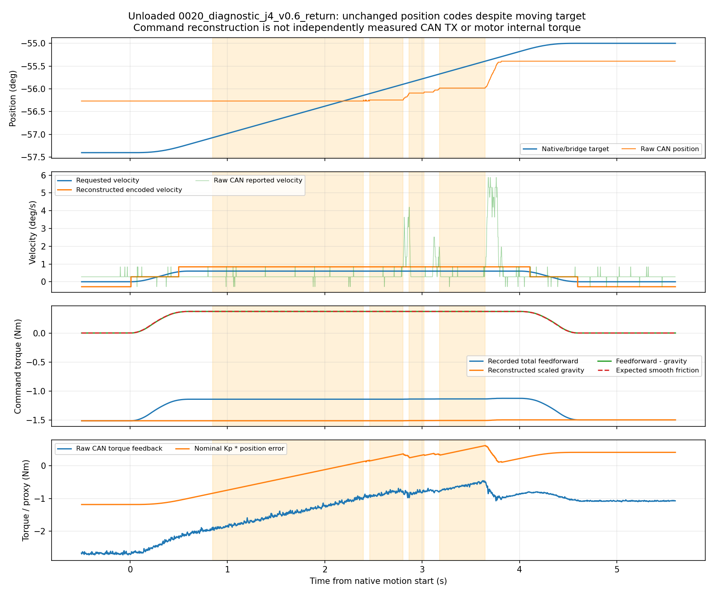

# 摩擦、死区和底层跟踪排查

来源：/home/venom/factr2/log/next_live_curve_20261019_v1。只读分析，无新运动、增益调整、模型修改或时延拟合。

## 量化与软件限幅

|关节|速度一个码 (°/s)|位置一个码 (°)|一位置码对应 Kp 力矩 (Nm)|零速半码对应 Kd 力矩量级 (Nm)|
|---|---:|---:|---:|---:|
|J1|1.259|0.02186|0.0267|0.0302|
|J2|1.259|0.02186|0.0267|0.0275|
|J3|0.560|0.02186|0.0267|0.0098|
|J4|0.560|0.02186|0.0229|0.0098|
|J5|1.399|0.02186|0.0038|0.0085|
|J6|1.399|0.02186|0.0134|0.0122|
|J7|1.399|0.02186|0.0038|0.0061|

上表Kd项仅是按软件解码计算的量级，不证明电机内部速度偏置。限幅计数是桥接入口相对配置限幅的计数，不覆盖电机电流/温度限幅。

## 匀速平台核查

|关节/方向|目标速度 (°/s)|同一位置码最长持续 (s)|这段时间目标走过 (°)|相当于位置码数|前馈减重力均值 (Nm)|平滑摩擦理论值 (Nm)|
|---|---:|---:|---:|---:|---:|---:|
|J1 out|0.6|0.317|0.190|8.7|+0.2603|+0.2603|
|J1 return|0.6|0.374|0.225|10.3|-0.2745|-0.2745|
|J2 out|0.6|0.489|0.293|13.4|+0.2603|+0.2603|
|J2 return|0.6|0.523|0.314|14.4|-0.2745|-0.2745|
|J4 out|0.6|0.577|0.346|15.8|-0.3521|-0.3521|
|J4 return|0.6|1.546|0.927|42.4|+0.3713|+0.3713|

## 到位后的残余位置误差

|关节/来向|前段速度 (°/s)|目标 (°)|实际平均 (°)|目标−实际 (°)|Kp误差力矩量级 (Nm)|额外重力前馈 (Nm)|
|---|---:|---:|---:|---:|---:|---:|
|J1 +1|0.6|2.400|2.047|+0.353|+0.431|-0.325|
|J1 -1|0.6|0.000|0.102|-0.102|-0.124|-0.348|
|J2 +1|0.6|52.400|52.026|+0.374|+0.457|+0.840|
|J2 -1|0.6|50.000|50.714|-0.714|-0.873|+0.824|
|J4 -1|0.6|-57.400|-56.267|-1.133|-1.187|+0.000|
|J4 +1|0.6|-55.000|-55.392|+0.392|+0.411|+0.000|

同目标、不同来向/路径历史的实际位置差混有重力偏差、静摩擦、控制器状态及机械回差，不能直接叫作机械死区宽度。

检测到 27 段“反馈位置码不变且目标走过至少4个位置码”的区间；其中 16 段在随后150 ms沿目标方向至少前进2个位置码。它是阻滞与释放的证据，未识别静摩擦系数。

所有逐段数值、软件限幅、编码示例、来源与解释边界见 diagnosis.json。原始CAN、实测力矩和前馈使用各自原时间戳，没有搜索或校正相位。
