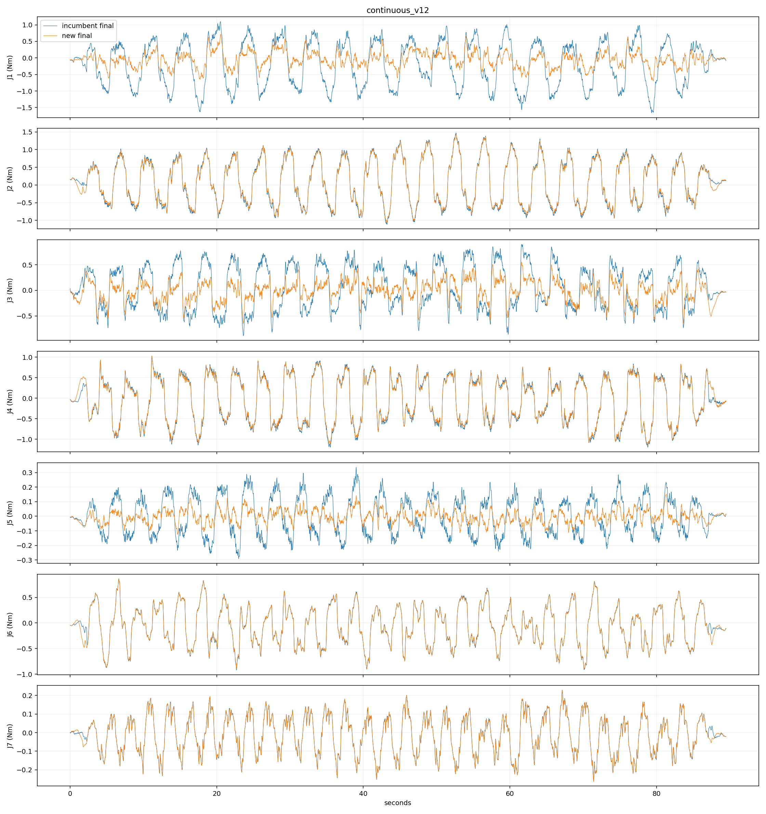

# 高速连续数据训练完成记录（2026-10-26）

训练已经全部完成；候选模型已导出但未替换现场观察模型。完整流程未通过预先固定的旧低速回归检查。

## 训练与数据

- 均值网络：沿用已完成的单 seed 0、20 轮输出层微调结果，冻结 LSTM，使用旧低速输出约束；没有重复训练均值网络。
- 配套方差头：本次完成 6 轮，第 1 轮按验证 NLL 选中，因验证耐心值提前停止；均值权重不变。
- 新补偿使用匹配新均值的预测缓存重新拟合；仅用训练数据拟合、验证数据选模式和正则强度。
- 补偿结果：velocity_acceleration，pooled，ridge=0.1；仅 J1/J3/J5 的补偿通过验证并启用，其余关节保留新均值及相同滤波。
- 三次新物理记录的角色保持不变，保留训练两段、验证两段、测试一段。测试中的 6°/s 档因 J4 0.36 秒疑似滞停整段排除，阈值保持 0.30 秒；新的高速独立测试仅覆盖 12°/s 上限档。旧低速记录沿用原划分。
- 输入、监督和离线评价保持完整数值精度；网页两位小数仅用于显示。
- 对比双方均使用相同的输入力矩 12 Hz 因果滤波和输出 5 Hz 因果滤波，RMS 为各关节等权的总体平方误差均值开方。

## 独立测试结果

|数据|原流程 RMS（Nm）|新流程 RMS（Nm）|RMS 变化|MSE 变化|
|---|---:|---:|---:|---:|
|新高速 12°/s 档|0.47520|0.36219|-23.78%|-41.91%|
|保留的旧低速|0.07841|0.08621|+9.95%|+20.88%|

|关节|高速原 RMS|高速新 RMS|旧低速原 RMS|旧低速新 RMS|
|---|---:|---:|---:|---:|
|J1|0.70264|0.23429|0.13317|0.15765|
|J2|0.64657|0.61743|0.07288|0.07439|
|J3|0.42830|0.20024|0.08419|0.09491|
|J4|0.56022|0.53651|0.09332|0.09382|
|J5|0.12972|0.04512|0.03006|0.02308|
|J6|0.37981|0.37627|0.05370|0.05374|
|J7|0.10301|0.10303|0.02032|0.02025|

## 部署判断与验证

预先固定的检查要求：高速测试 MSE 至少改善 5%，旧低速 MSE 上升不得超过 15%，逐关节 RMS 增量不超过 max(旧 RMS 的 20%, 0.02 Nm)，高速姿态范围支持率至少 98%。
新均值单独的测试检查通过；完整流程的高速 MSE 改善 41.91%，但旧低速 MSE 上升 20.88%，因此完整部署检查不通过。旧低速误差增加主要集中在 J1、J3。没有用测试结果重新拟合、修改启用关节或降低阈值。
逐帧在线类与向量化离线补偿计算的最大数值差为 4.02e-16 Nm；高速测试姿态支持率为 100%。导出的均值/方差与离线计算一致性检查通过，两个观察程序的 check-only 加载检查通过。相关自动测试 27 项通过、1 项跳过。
这些数值是空载条件下报告力矩的残差，尚未验证真实已知外力接触；sigma 未独立校准。当前结果不能宣称全速度范围均改善。下一轮若继续改进，需要保留本次失败结果，并使用新的独立确认数据评估。

## 保存位置

- 均值训练：highspeed_mean_20261025_v3（原始路径：`data/right/highspeed_mean_20261025_v3`，见备份清单）
- 方差头训练：highspeed_sigma_20261025_v1（原始路径：`data/right/highspeed_sigma_20261025_v1`，见备份清单）
- 候选观察模型：highspeed_observer_20261025_v1（原始路径：`models/w3/right/highspeed_observer_20261025_v1`，见备份清单）
- 补偿模型：highspeed_compensation_20261025_v1（原始路径：`data/right/highspeed_compensation_20261025_v1`，见备份清单）
- 详细比较：[comparison.json](candidate_evaluation/comparison.json)
- 高速波形：[heldout_waveforms.png](candidate_evaluation/heldout_waveforms.png)

