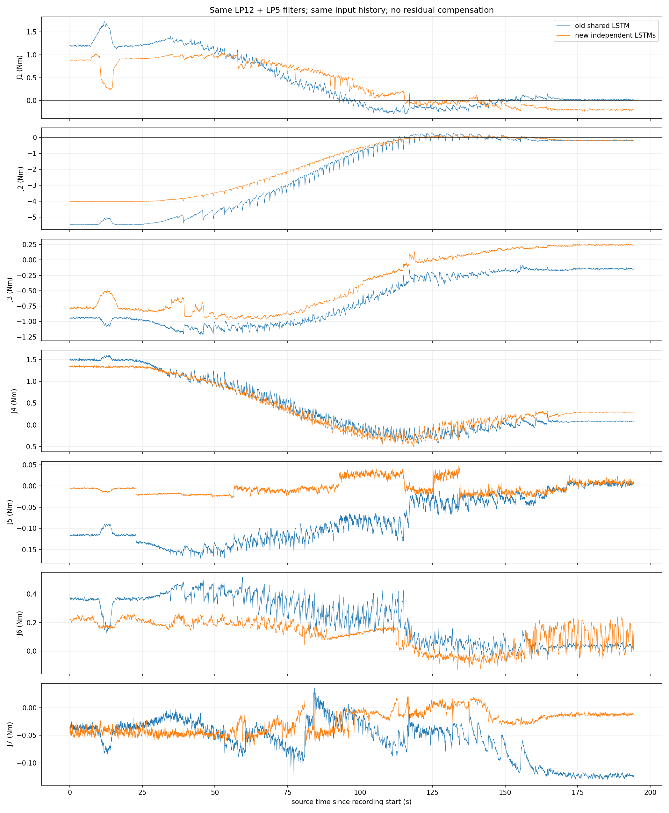
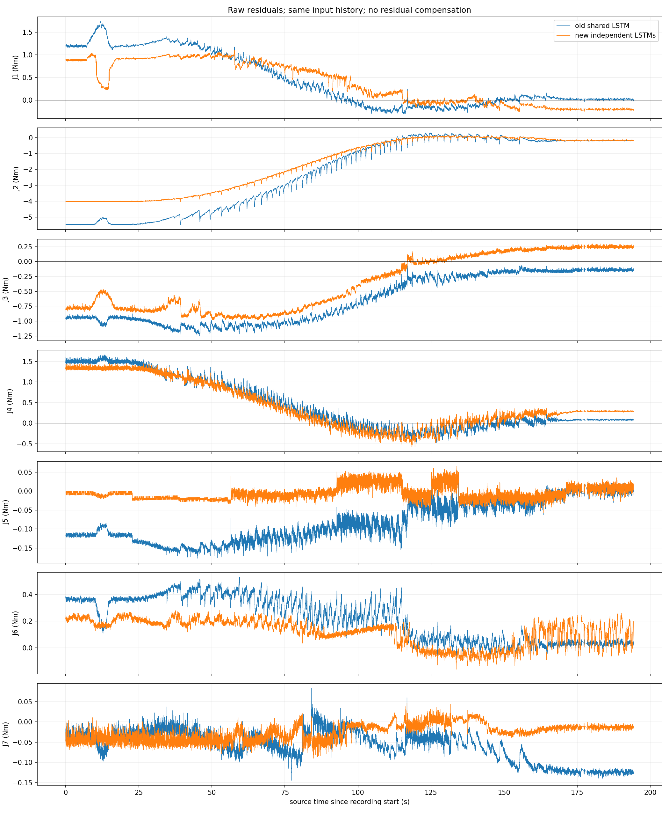

# 新旧 LSTM 同轨迹实机对比

执行状态：failed；完成 3 个动作段。
两个模型读取同一50帧历史，各使用原有归一化；附加残差补偿和sigma均关闭，输出滤波同为12Hz再5Hz。
比较原始残差及滤波残差。统计仅使用完整160秒正式段中间140秒、两个模型均标记有效的同一批帧。越界数据保留。
记录 19283 帧，源最大间隔 760.01ms，正式段共同有效率 0.00%。

未完成正式段，不据此宣称正式高速段性能。

最大跟踪误差 1.452°。未根据本次数据重新训练、调整补偿或自动归零；空载残差不等同于真实接触精度。

原始采集：`/home/venom/factr2/data/quick_capture/right/20261030_105813_514952`。
同帧全精度记录：`/home/venom/factr2/log/joint_lstm_live_comparison_20261030_v1/samples.csv`。

## 本次保护中止说明

完成小幅试走、返回和158.55秒进位，未完成正式高速段。进位后静止阶段触发 `Paired model output stale`；停机附近模型重建50帧历史，原子模型输出源时间相邻间隔约0.75秒。触发250ms新鲜度保护后未自动重试、未放宽阈值。延迟的具体计算或调度来源尚未确定。

底层采集质量PASS：19306行，100.04Hz，最大源间隔13.37ms；配对模型记录19283帧。机器人停在工作姿态附近，退出后只读复核4秒编码器波动不超过0.022°，无运动指令发布者。

波形包含训练范围外的进位数据，不能据此计算正式高速对比结论。

[末端等效力波形](endpoint_force_waveforms.png)（无效估计保留为空白；工具受力假设成立时才显示，不是力传感器实测）。
