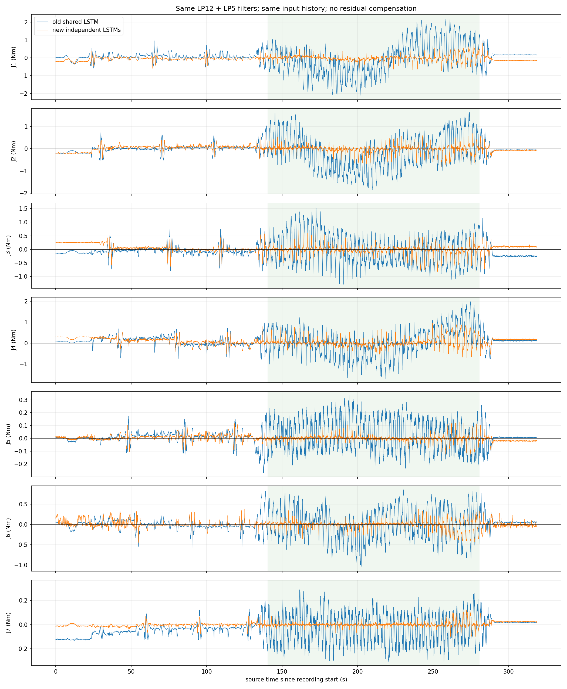
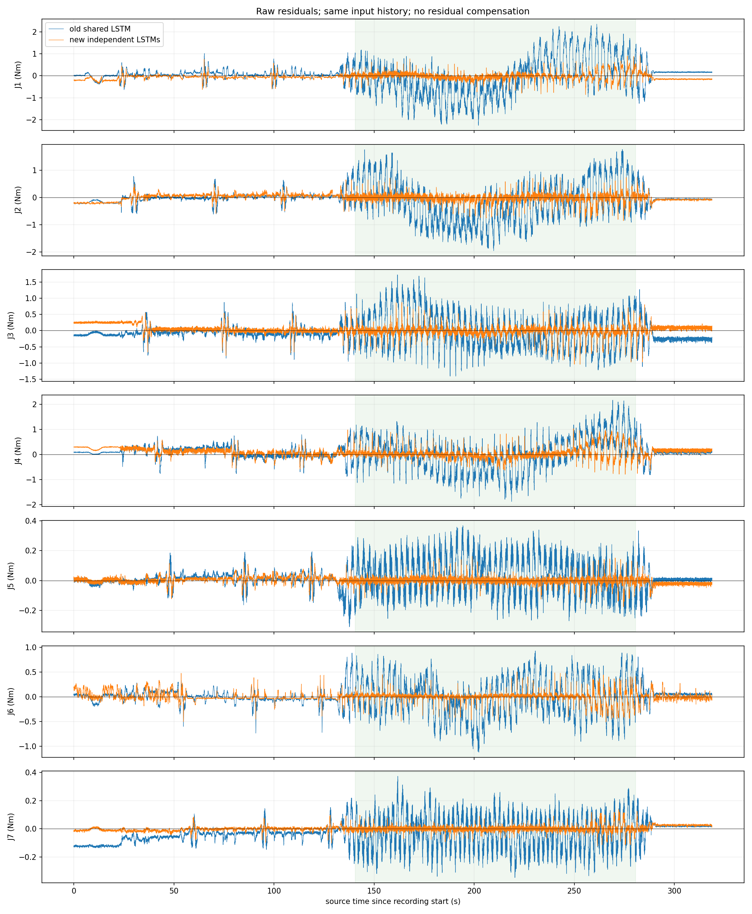

# 新旧 LSTM 同轨迹实机对比

执行状态：completed；完成 27 个动作段。
两个模型读取同一50帧历史，各使用原有归一化；附加残差补偿和sigma均关闭，输出滤波同为12Hz再5Hz。
比较原始残差及滤波残差。统计仅使用完整160秒正式段中间140秒、两个模型均标记有效的同一批帧。越界数据保留。
记录 31898 帧，源最大间隔 13.41ms，正式段共同有效率 96.16%。

|关节|旧原始RMS Nm|新原始RMS Nm|旧同滤波RMS Nm|新同滤波RMS Nm|
|---|---:|---:|---:|---:|
|J1|0.91063|0.18041|0.90125|0.16839|
|J2|0.76846|0.17495|0.75835|0.15628|
|J3|0.53958|0.16696|0.52585|0.15301|
|J4|0.64231|0.22643|0.63203|0.21464|
|J5|0.12856|0.02494|0.12276|0.02144|
|J6|0.37373|0.10127|0.36695|0.09344|
|J7|0.13076|0.02217|0.12610|0.01959|

同滤波整体RMS：0.56429 → 0.13724 Nm。

最大跟踪误差 1.260°。未根据本次数据重新训练、调整补偿或自动归零；空载残差不等同于真实接触精度。

原始采集：`/home/venom/factr2/data/quick_capture/right/20261030_111850_159473`。
同帧全精度记录：`/home/venom/factr2/log/joint_lstm_live_comparison_20261030_v2/samples.csv`。

