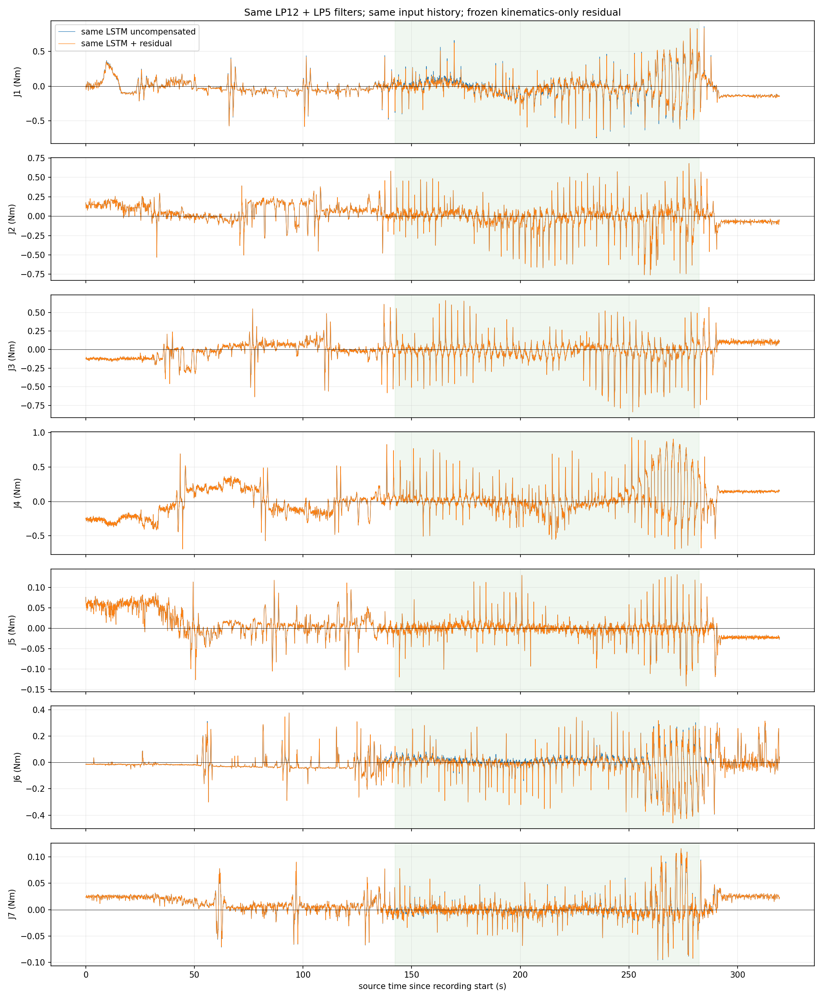
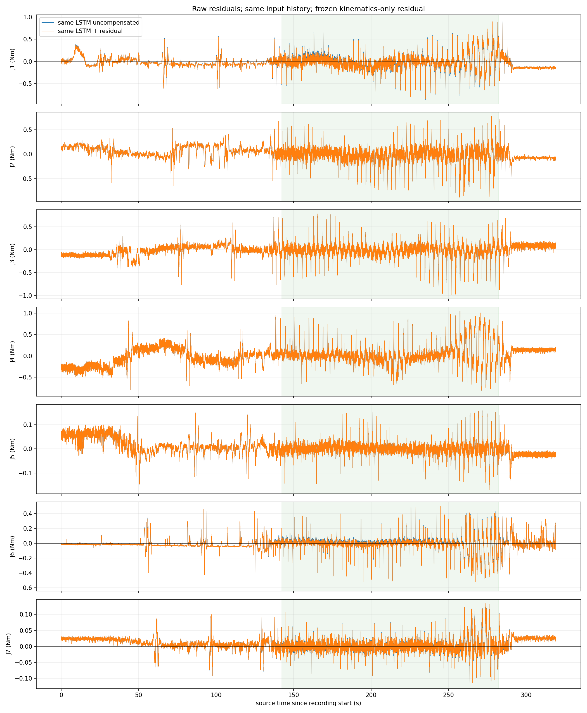

# 同一独立 LSTM 残差补偿实机对比

执行状态：completed；完成 27 个动作段。
同一冻结独立LSTM同时生成未补偿和补偿后输出；使用相同50帧历史、相同12Hz再5Hz滤波，sigma关闭。
比较原始残差及滤波残差。统计仅使用完整160秒正式段中间140秒、两个模型均标记有效的同一批帧。越界数据保留。
记录 31946 帧，源最大间隔 13.38ms，正式段共同有效率 95.75%。

|关节|旧原始RMS Nm|新原始RMS Nm|旧同滤波RMS Nm|新同滤波RMS Nm|
|---|---:|---:|---:|---:|
|J1|0.18062|0.17736|0.16875|0.16525|
|J2|0.17058|0.17058|0.15226|0.15226|
|J3|0.16552|0.16552|0.15141|0.15141|
|J4|0.22980|0.22980|0.21781|0.21781|
|J5|0.02530|0.02530|0.02177|0.02177|
|J6|0.10228|0.10237|0.09478|0.09506|
|J7|0.02194|0.02183|0.01939|0.01933|

同滤波整体RMS：0.13725 → 0.13667 Nm。

最大跟踪误差 1.319°。补偿在本次运动前冻结，本次记录未用于重新训练、调参或自动归零；空载残差不等同于真实接触精度。

原始采集：`/home/venom/factr2/data/quick_capture/right/20261030_120344_342482`。
同帧全精度记录：`/home/venom/factr2/log/joint_residual_comparison_20261030_v2/samples.csv`。

