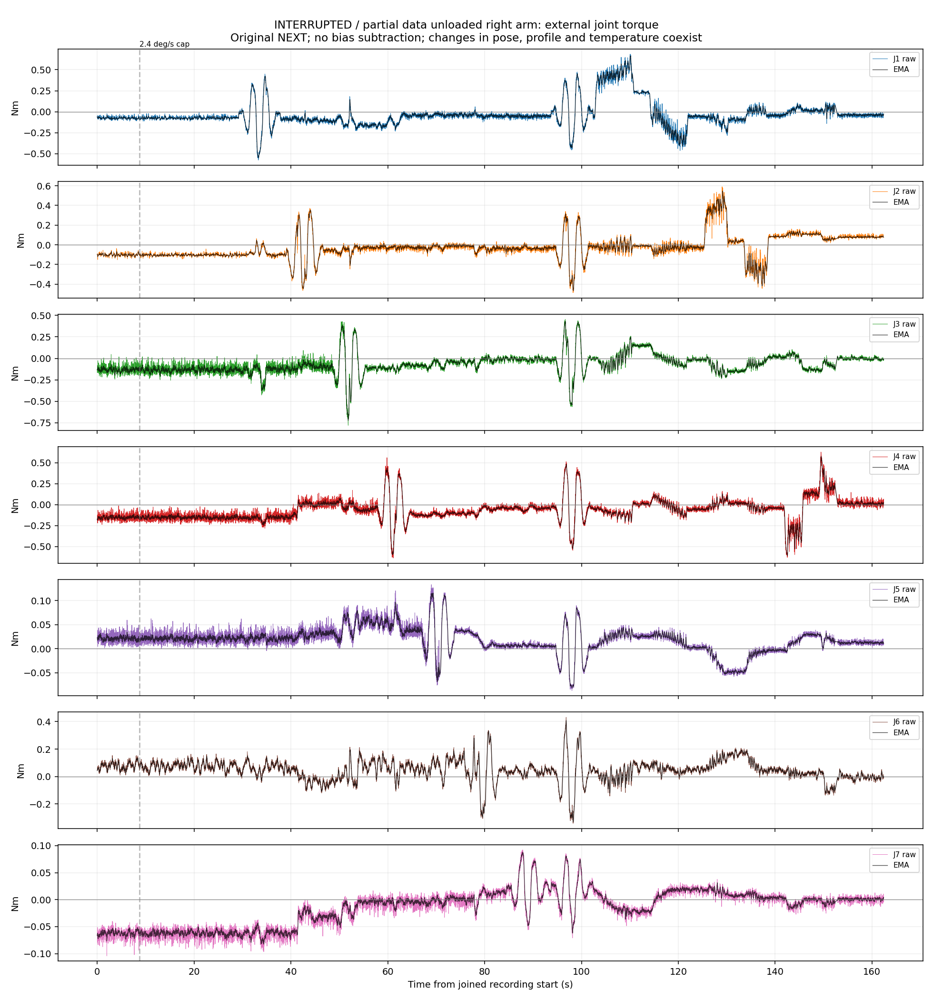
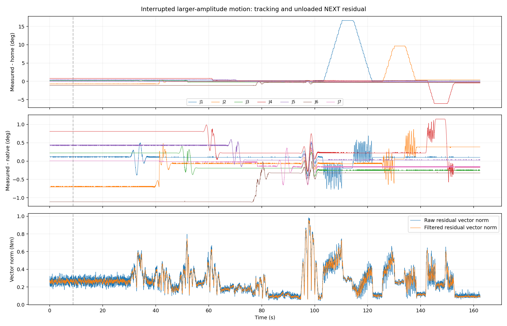

# 较大幅度、长时间空载观测

完成 19/55 段，尝试 20 段；规划命令时间 676.21 秒；七路同步结果 16185 行，跨度 162.41 秒。
最新窗口显示七关节外部力矩（N·m），没有雅可比换算或自动归零。原版NEXT模型、增益、重力和摩擦前馈保持固定。

**实验中断，未完成长时间协议。停止原因：状态/command_state/real adapter 失效或超过 250ms；停止后续发送。未完成运动段不计入完成段统计；最后静止值取停止后记录末尾5秒，不是规划的最终30秒静止段。**

|阶段|七轴原始残差向量 RMS (Nm)|七轴滤波残差向量 RMS (Nm)|
|---|---:|---:|
|初始静止最后15秒|0.2700|0.2648|
|已完成运动（含小幅验证）|0.3309|0.3257|
|停止后记录末尾5秒|0.0976|0.0922|

向量RMS是七个关节力矩的统计量，不是末端力。

|关节|实际角度范围 (°)|运动原始残差 RMS (Nm)|运动绝对残差 P95 (Nm)|运动绝对峰值 (Nm)|初始静止均值 (Nm)|停止后末尾5秒均值 (Nm)|最大跟踪偏差 (°)|
|---|---:|---:|---:|---:|---:|---:|---:|
|J1|-0.07～16.63|0.1857|0.4336|0.6860|-0.0746|-0.0378|0.779|
|J2|49.29～59.68|0.1430|0.3512|0.5898|-0.1039|+0.0788|0.867|
|J3|-0.28～0.24|0.1405|0.3050|0.7805|-0.1353|-0.0055|0.460|
|J4|-61.05～-54.17|0.1534|0.3532|0.6379|-0.1530|+0.0099|1.147|
|J5|-0.02～0.46|0.0356|0.0717|0.1334|+0.0211|+0.0127|0.596|
|J6|-1.13～-0.08|0.0949|0.1913|0.4315|+0.0782|-0.0042|1.120|
|J7|-0.19～0.01|0.0307|0.0676|0.0965|-0.0619|+0.0007|0.654|

## 数据质量与解释边界

H5质量检查：False；CSV最大间隔 513.33 ms；共同时间范围内，七路完整记录覆盖H5源帧 99.85%。
原始CAN 389216 帧，接收丢帧 0，内核时间戳缺失 0；本次NEXT计数变化 {'dropped': 1, 'resets': 4}。累计计数包含启动前的恢复，不能当作本次丢帧。
空载真值来自操作者说明，仍无独立外部力矩传感器。本次仅到达2.4°/s命令速度上限档；4°/s与6°/s档未执行，不能给出高速性能结论。姿态、运动方向和运动历史同时变化，不能据此单独认定惯性、摩擦或热漂移的因果关系。反馈速度、源时间与电机采样时间也必须区分。
温度为固件提供的标称MOS/转子摄氏度；温度、各轴实测/预测力矩、分段误差、推理耗时和状态统计见 observation_summary.json。

原始会话：/home/venom/factr2/data/quick_capture/right/20261023_104838_802791。保留H5、完整压缩bag、原始CAN、温度、实际参数、模型标识和冻结轨迹。
本次为独立诊断数据，不自动转入训练；没有拟合或补偿新时延。

## 已录数据结论与停止事件复核

用户选择“保持时间同步，先总结已录数据”。没有暂停NTP、修改系统时钟、放宽保护门限或继续发送运动指令。只读复核记录在 `summary_readonly_state.json`：NTP=yes、NTPSynchronized=yes，位置控制器与重力补偿控制器active，8081/8082检测服务valid，输出100Hz。

完成19/55段；第20段为J4大幅运动返回，发生停止。因此本次是约162秒的中断观测，不是完整676秒协议。实测J1角度跨度约16.70°、J2约10.38°、J4约6.88°；最大记录跟踪偏差1.147°，未达到既有3°跟踪停止门限。

原始CAN相邻帧的主机墙钟与内核实时时间戳同步向后跳约553.64ms，而同一对帧的单调接收时间仍向前0.405ms；详见 `clock_step_evidence.json`。诊断同时出现 `invalid:clock_rollback` 与输入超时，触发状态新鲜度保护并停止。这是本次停止的直接时序证据。该记录证明时钟发生回退，但不单独证明是哪一时间服务或上游源导致了回退；本次没有将其归因为机械臂奇异点。

空载残差仍存在：初始静止七轴向量RMS为0.2700Nm，已完成运动为0.3309Nm；运动绝对峰值以J3约0.781Nm、J1约0.686Nm、J4约0.638Nm较明显。滤波将运动RMS从0.3309降到0.3257Nm（约1.55%），说明当前结果不能仅解释为高频噪声。曲线中存在随动作变化的偏置和低频变化；这些现象与姿态相关模型误差、摩擦/方向历史、跟踪及反馈误差相容，但本次试验不足以将它们唯一分离。

初始静止与停止后末尾5秒的均值不同，例如J2由−0.1039变为+0.0788Nm；但两段实际姿态、到位方向、历史与静止时长不完全一致，不能把末尾RMS较低解释为已验证归零或漂移修复。

H5中主连续段ep_0001有15282行、152.87秒，约99.96Hz，最大间隔13.45ms；会话整体质量未通过，是因为中断产生的ep_0002仅23行、0.22秒，被标记为excluded/too_short。完整原始日志均保留，异常段与正常段必须区分。本次仍作为独立诊断数据，不自动并入训练。
