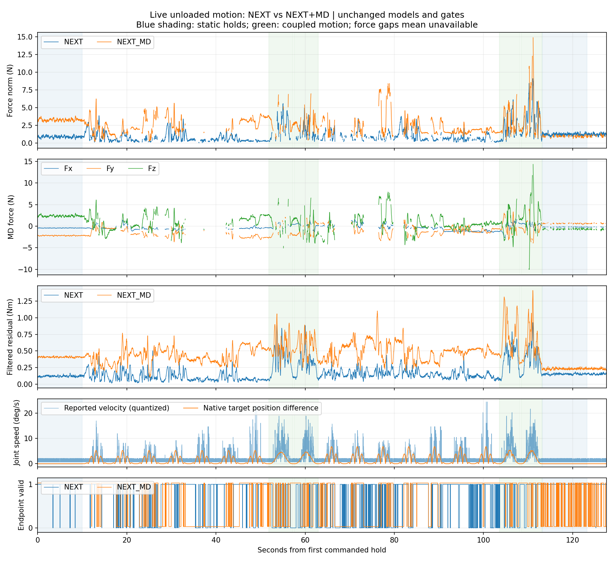

# NEXT 与 NEXT+MD 真机空载运动观测

执行状态：completed；完成 20/20 块，计划命令时长 119.37 秒。

两组使用实际在线发布结果，逐时间戳记录；没有改模型、阈值、滤波或扣零。静止取首末10秒的最后5秒。

| 阶段 | 模型 | 末端可用率 | 力幅值均值 N | P95 N | 峰值 N |
| --- | --- | ---: | ---: | ---: | ---: |
| 运动前静止 | NEXT | 97.8% | 0.856 | 1.106 | 1.255 |
| 运动前静止 | NEXT_MD | 100.0% | 3.253 | 3.512 | 3.825 |
| 运动 | NEXT | 72.1% | 1.109 | 3.522 | 9.084 |
| 运动 | NEXT_MD | 61.6% | 2.478 | 5.158 | 14.858 |
| 运动后静止 | NEXT | 100.0% | 1.212 | 1.472 | 1.635 |
| 运动后静止 | NEXT_MD | 46.8% | 0.916 | 1.135 | 1.321 |

## 同一批共同有效时间戳

| 阶段 | 共同有效比例 | 模型 | 力幅值均值 N | P95 N |
| --- | ---: | --- | ---: | ---: |
| before | 97.8% | NEXT | 0.856 | 1.106 |
| before | 97.8% | NEXT_MD | 3.252 | 3.508 |
| motion | 47.6% | NEXT | 1.062 | 3.261 |
| motion | 47.6% | NEXT_MD | 2.488 | 5.164 |
| after | 46.8% | NEXT | 1.221 | 1.498 |
| after | 46.8% | NEXT_MD | 0.916 | 1.135 |

完整指标、关节偏置/标准差、拒绝原因及实际回位差见 analysis.json。无效末端区间保留为空，不计作零外力。

空载、无接触依据本次操作者声明，没有独立力传感器，不能据此认证实际接触力精度。MD沿用启动以来的在线运动历史，未为本次实验重置。此数据仅观测，不加入训练。

6和10°/s是速度限制；本次原生目标峰值分别为 v06_a15: 5.25°/s, v10_a20: 6.78°/s。速度反馈尖峰不能直接视为真实运动速度。

原始四流、控制快照、运动跟踪及CAN：/home/venom/factr2/data/quick_capture/right/20261016_223606_187477

