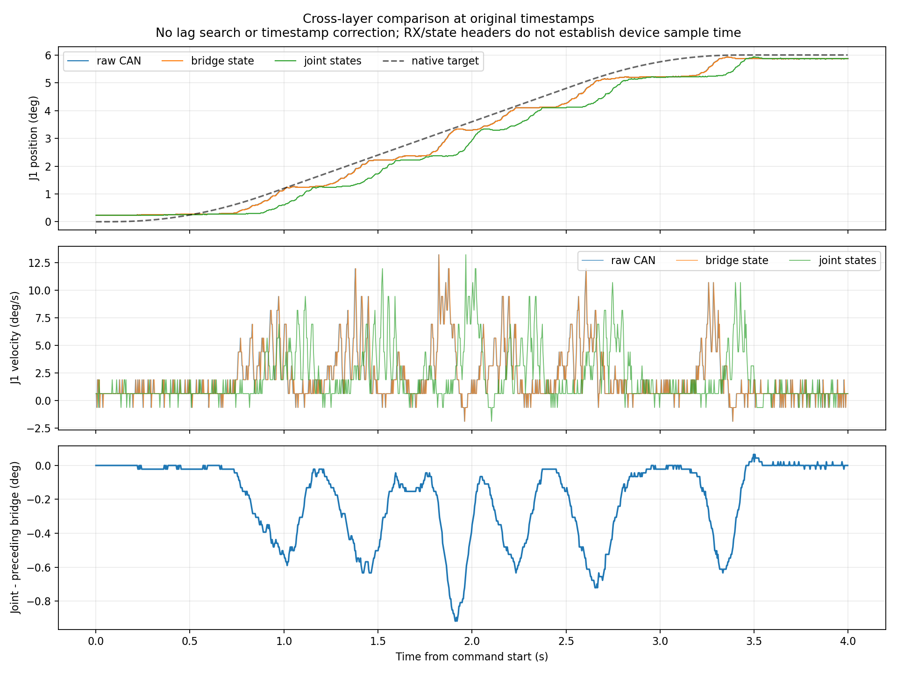
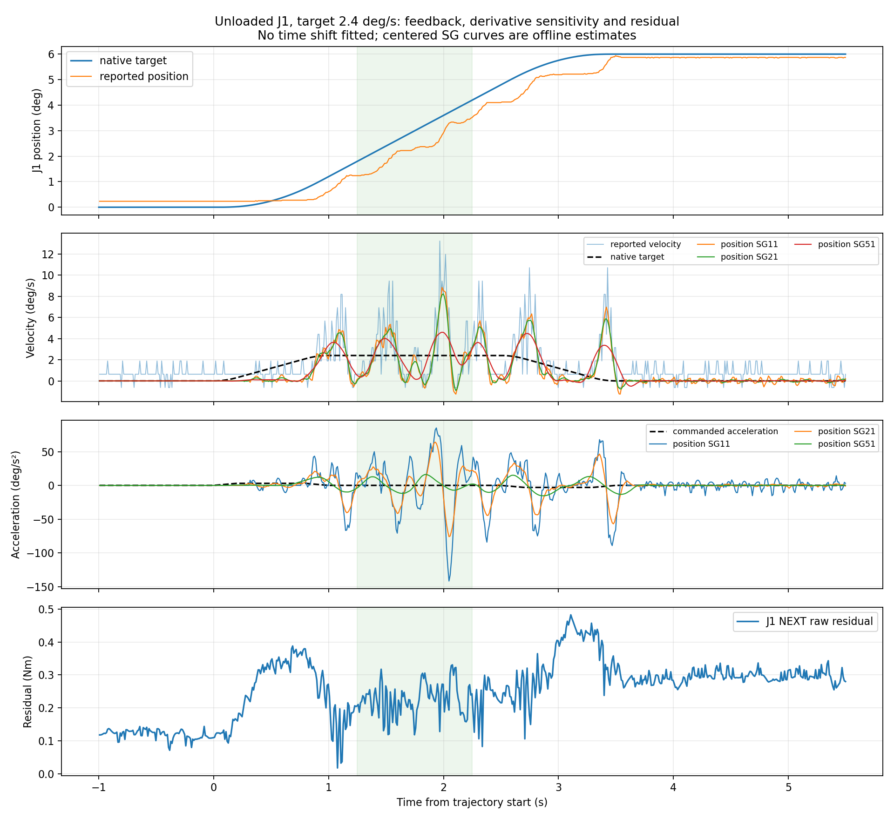
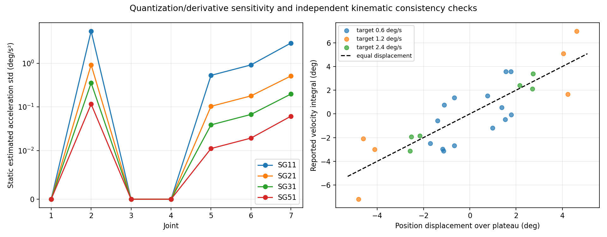

# 位置、速度反馈与底层跟踪专项验证

执行完成：62 段，26 次正式往返单程，35806 行 NEXT 同步结果。
左臂保持不动；右臂回到原目标。原版 NEXT、控制增益、摩擦前馈及在线滤波未修改。本批为独立诊断数据，不混入训练。

## 本轮发现及处理优先级

1. **优先排查底层反馈积压。** 按原时间戳、只匹配此前最近消息，CAN 与驱动发布状态的最大位置差约 0.0219°，但驱动状态到 `/joint_states` 的最大位置差约 1.071°。原生目标和驱动入口命令吻合。这把较大的反馈阶段性落后定位在驱动发布之后、关节状态输出之前；不能把全部目标—反馈相位差当作机械响应。
   真实日志中驱动状态约350 Hz、硬件循环约300 Hz。当前硬件接口订阅 `KeepLast(50)`，每次 read 调用 `rclcpp::spin_some`，随后用控制周期时间戳重新发布关节状态，没有保留被消费反馈的原始时间戳。这与队列积压相符；应优先检查最新样本消费和源时间戳传播。这里没有在测试日志上估计或应用新的补偿延迟。
   adapter记录的状态/命令源时间戳相同并不推翻这个发现：硬件接口的 `on_motor_state` 把位置、速度、力矩写入缓存时没有传播接收消息原header；关节广播使用新的控制周期时间戳。因此下游 `source_skew=0` 不能证明真实采样同步。旧状态与新目标混合会影响NEXT的跟踪误差输入，可能被解释为外力；本轮没有做参数修正来证明其贡献比例。
2. **速度存在接近半个码的基线偏差。** 不同方向的“速度平台均值−位置位移均速”与静止速度基线接近，不能仅按随机噪声解释。以下是原始差值的描述统计，没有从数据中拟合修正系数或修改输入：

|关节|平台速度差范围 (°/s)|静止前速度均值 (°/s)|
|---|---:|---:|
|J1|+0.609 至 +0.644|+0.656|
|J2|-0.660 至 -0.551|-0.599|
|J3|-0.292 至 -0.274|-0.278|
|J4|+0.253 至 +0.299|+0.283|
|J5|-0.689 至 -0.686|-0.715|
|J6|-0.744 至 -0.686|-0.693|
|J7|+0.693 至 +0.702|+0.689|

   需核实电机固件的零速度码定义和协议映射。修复时须统一训练、采集和推理的速度定义；本轮没有自动扣除静止基线。
3. **跟踪脉动与求导放大同时存在。** J1 目标峰速2.4°/s时，原始 CAN 速度峰值约 13.22°/s；原始 CAN 位置和速度都出现脉动，说明不能全部归为数值求导伪影。但位置求导的加速度峰值随SG11/21/51分别为 141.6/76.0/16.2°/s²，而目标加速度仅3°/s²。这些峰值不是独立测得的真实加速度。
   队列问题解决后，应以同一协议复测；若 CAN 层仍有脉动，再分辨摩擦、死区、重力前馈和底层闭环动态。当前证据不支持直接依据某个求导窗口增加惯性扣除项。

隔离的软件复现（专用ROS域、无机器人话题）采用350 Hz发布、300 Hz调用相同的 `spin_some` 读取方式：
深度50的缓存样本年龄中位数 141.45 ms；深度1为 1.44 ms。该结果支持积压机制，但只是模拟消息实验，不是对真机时延的拟合或新补偿标定。

## 运动与分析方法

起止各静止15秒；七关节安全探测后再静止10秒；七关节分别以0.6°/s走2.4°往返；J1/J2/J4另以1.2与2.4°/s走6°往返。每次到位单独标注3秒停留。每个运动段一次发送完整原生轨迹，不由上位机分段插值发送。
采集前冻结 SG11/21/31/51（100 Hz、三阶多项式）和有限差分对照；匀速平台两端各裁0.25秒，用位置位移与速度积分核对。所有跨层匹配只取此前最近样本，没有拟合、搜索或应用新的时间平移。

## 信号链与量化

原始 CAN 共 877084 帧，内核时间戳缺失和接收丢帧均为0；CAN 时间是主机接收时间，不是电机采样时间。原始adapter/H5维持100 Hz，最大间隔约13.31 ms；NEXT七路同步观测CSV最后静止段有一次 159.99 ms缺口，已排除所有触及缺口的求导窗口。26次正式运动段均未跨越缺口。

|关节|位置 LSB (°)|速度 LSB (°/s)|静止前位置跨度 (°)|静止前速度均值 (°/s)|SG11/SG51 静止加速度标准差 (°/s²)|
|---|---:|---:|---:|---:|---:|
|J1|0.02186|1.259|0.0000|0.656|0.000 / 0.000|
|J2|0.02186|1.259|0.0219|-0.599|5.428 / 0.116|
|J3|0.02186|0.560|0.0000|-0.278|0.000 / 0.000|
|J4|0.02186|0.560|0.0000|0.283|0.000 / 0.000|
|J5|0.02186|1.399|0.0219|-0.715|0.528 / 0.011|
|J6|0.02186|1.399|0.0219|-0.693|0.914 / 0.019|
|J7|0.02186|1.399|0.0219|0.689|2.893 / 0.061|

速度映射为偶数个离散码，在当前标称解码下零附近为半个速度码；不能把静止时的小非零值直接当作真实运动。量化只是误差来源之一，内部滤波、编码器与电机固件尚未独立标定。求导的量化界仅覆盖位置量化误差，不覆盖真实动态与平滑偏差。

## 原生目标与底层跟踪

原生目标与冻结轨迹的最大位置差 0.000035°。桥接命令和原生目标按原时间戳比较，各轴最大位置差为 [3e-06, 7e-06, 7e-06, 1e-06, 7e-06, 7e-06, 3e-06]°。
记录到了硬件接口发布给驱动的命令；原始 CAN 没有独立可用的发送回显，因此重建的命令量化值只是按当前驱动映射计算，不能证明实际发送时刻或电机内部执行延迟。

|关节/方向|目标速度 (°/s)|平台位移均速 (°/s)|反馈速度均值 (°/s)|速度积分−位移 (°)|SG11/SG51 速度峰值 (°/s)|SG11/SG51 加速度峰值 (°/s²)|跟踪误差绝对峰值 (°)|
|---|---:|---:|---:|---:|---:|---:|---:|
|J1 out|2.4|2.731|3.374|0.647|8.84 / 4.60|141.6 / 16.2|0.997|
|J1 return|2.4|-2.535|-1.925|0.607|9.61 / 4.74|144.7 / 16.9|0.961|
|J2 out|2.4|2.710|2.111|-0.593|8.59 / 5.15|109.5 / 19.1|0.914|
|J2 return|2.4|-2.579|-3.130|-0.553|9.55 / 6.14|117.7 / 23.1|1.231|
|J4 out|2.4|-2.164|-1.865|0.300|6.85 / 4.11|63.7 / 11.3|1.309|
|J4 return|2.4|2.170|2.423|0.246|6.72 / 3.29|112.6 / 12.2|1.018|

## 解释边界

单一求导窗口给出的尖峰不能作为独立真实加速度证据。宽窗口降低噪声，也会衰减真实短时动态；不同窗口的范围是方法敏感性，不是置信区间。若原始速度和位置增量都支持脉冲运动，且原生/桥接目标保持平滑，则更支持实际跟踪或底层反馈链存在脉动；仍需独立编码器才能排除共同反馈误差。
本次无外部速度/力传感器，无接触真值来自操作者说明，未重新估计延迟、修改零偏、在线滤波、模型或控制参数。下一步应根据下面曲线及定量结果区分求导不确定性和真实跟踪问题，再设计干预，不能直接把残差按求导加速度扣除。

原始会话：`/home/venom/factr2/data/quick_capture/right/20261016_234400_384531`。完整数字见 `feedback_analysis.json`，冻结运动/方法见 `motion.yaml`、`test_spec.json`。
