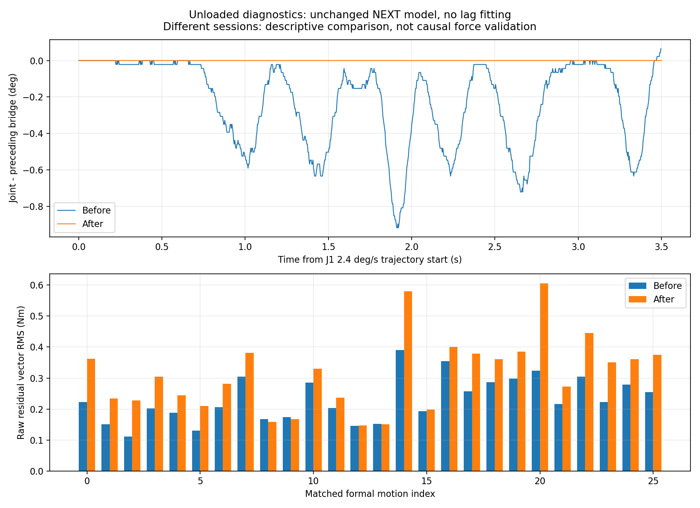

# 最新反馈消费真机对照

原版 NEXT 模型、增益、滤波和分析窗口保持固定。右臂空载、左臂保持；无独立力传感器。两次实验日期、温度和初始实际姿态不同，因此以下为描述性前后对照，不能单凭残差变化归因于代码修复。

|指标|修复前|修复后|
|---|---:|---:|
|桥接→关节状态最大位置差 (°)|1.070974|0.021857|
|CAN→桥接最大位置差 (°)|0.021883|0.021881|
|正式运动残差向量 RMS 的单程均值 (Nm)|0.231628|0.313544|
|初始静止残差向量 RMS (Nm)|0.0660|0.4477|
|最终静止残差向量 RMS (Nm)|0.1645|0.1911|

新源时间话题入袋年龄：P50=1.774 ms，P95=2.821 ms，最大=4.798 ms。该年龄包含发布、调度和入袋，不是电机采样到控制的完整物理时延。旧版本没有保留这一路源时间，不能构造同名时延前后差。

硬件读周期内，各右臂关节源年龄 P95 最大值=2.737 ms；源年龄最大值=5.086 ms；有效性监测共记录 0 个关节失效样本。

|正式运动末端力输出|修复前|修复后|
|---|---:|---:|
|有效输出覆盖率|0.7120|0.6954|
|有效帧力范数 RMS (N)|1.9319|2.8616|
|有效帧力范数 P95 (N)|3.5876|5.5169|

末端力统计只覆盖通过求解器和状态检查的有效帧；缺失/奇异帧没有填零。力矩残差使用原始 NEXT 输出，末端力使用现有发布的滤波输出，两者不能直接互换。

|关节|修复前跨层位置差峰值 (°)|修复后跨层位置差峰值 (°)|修复前静止速度 (°/s)|修复后静止速度 (°/s)|
|---|---:|---:|---:|---:|
|J1|0.93983|0.02186|+0.656|+0.657|
|J2|1.07097|0.02186|-0.599|-0.600|
|J3|0.63384|0.00000|-0.278|-0.280|
|J4|0.74312|0.00000|+0.283|+0.279|
|J5|0.43713|0.02186|-0.715|-0.686|
|J6|0.17485|0.02186|-0.693|-0.685|
|J7|0.89612|0.02186|+0.689|+0.701|

## 结果解释

反馈消费这一段的积压已明显改善，但旧 NEXT 的空载误报并未通过验收。时序修复会同时改变闭环跟踪及模型历史输入；模型在旧通路上训练，即使控制参数相同，也不能保证新输入分布仍匹配。本轮没有在独立日志上重拟合或补偿这一变化。
本轮 J1 目标峰速 2.4°/s，原始 CAN 速度峰值仍达 11.96°/s；位置出现停住再追赶的阶梯。SG11/21/51 的加速度峰值为 131.0/76.4/17.3°/s²，说明求导不确定性仍然很大。原始反馈同时支持脉动现象，需要排查摩擦、死区、前馈与底层闭环；缺少独立编码器，不能把这些峰值当作真实加速度标定。
正式运动中末端力拒绝原因计数：{'ok': 8275, 'inconsistent_with_tool_contact': 3625}。本次拒绝均标为力矩残差与工具接触模型不一致，不能把这批缺失输出全部归于奇异点。
静止时仍有接近半个速度码的非零读数，且速度积分与位置位移不一致。应先核对固件和驱动的零速度定义，再统一采集、训练与推理；仅对在线速度减去本批均值会引入新的不一致。

|关节|初始残差均值 ± 标准差 (Nm)|最终残差均值 ± 标准差 (Nm)|
|---|---:|---:|
|J1|-0.3429 ± 0.0124|+0.0846 ± 0.0144|
|J6|+0.1673 ± 0.0123|-0.1444 ± 0.0179|

静止残差均值远大于短时波动，单纯加强低通无法解决不归零问题。
起止目标相同，但实际静止角度最大相差 1.436°。因此当前前后偏置还混有姿态变化与重力变化，不能单凭同一指令目标证明摩擦滞回。实际位置、目标、实测力矩和模型预测均值见 static_input_audit.json。

下一步建议：先确认固件速度码与单位，再在新反馈通路下检查摩擦/死区及底层跟踪；信号定义固定后，另采训练集和验证集重新训练 NEXT。本次诊断及旧对照继续留作独立测试集，延迟只允许在训练数据上估计后冻结。

未拟合新延迟，未扣除零偏，未修改模型输入或补偿残差。若反馈新鲜度恢复但 CAN 速度偏置和空载残差仍存在，应分别核实固件速度码与训练输入定义、摩擦和热漂移；新反馈时序下模型可能需要重新验证或重新训练。

修复前：/home/venom/factr2/log/next_feedback_trial_20261016_v2；修复后：/home/venom/factr2/log/next_feedback_trial_20261019_v1。完整覆盖率、拒绝原因和静止每轴均值/标准差见 comparison.json。
