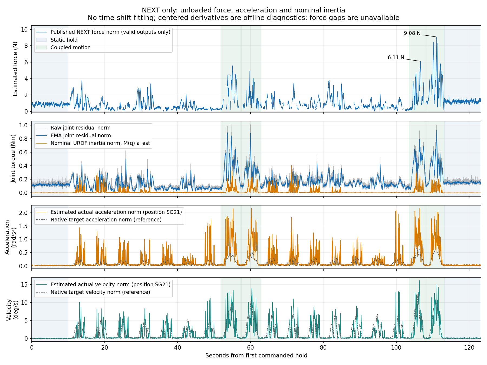
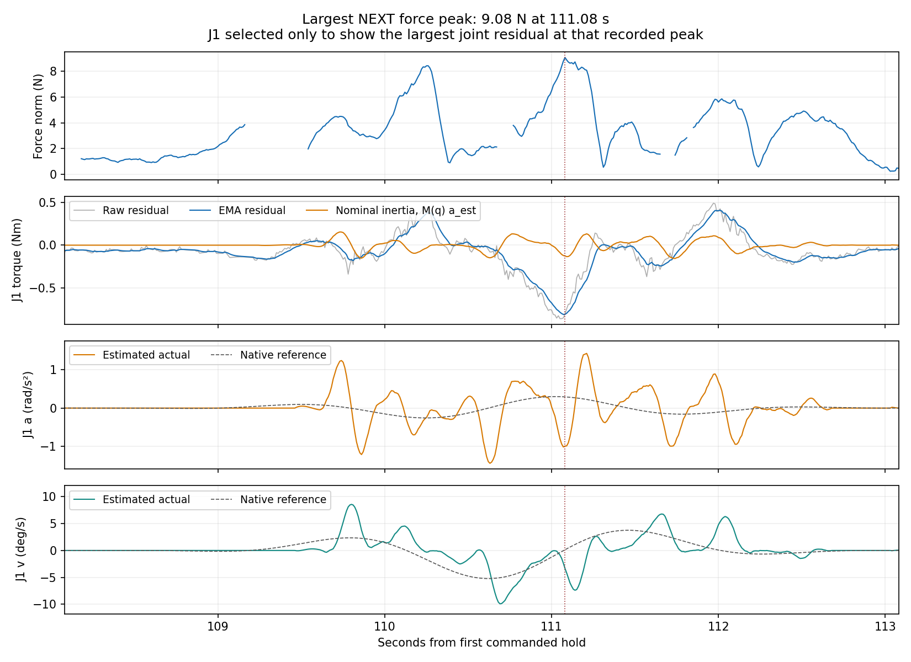

# 原版 NEXT：惯性对空载外力曲线的影响

结论：加减速及多关节联动动态与残差增大有关，但现有日志不足以将惯性认定为主要或唯一根因。名义URDF惯性项与残差的有符号相关较弱；停止数秒后的持续偏置也不能由普通惯性力矩解释。

数据来源：/home/venom/factr2/log/md_force_observation_20261016_223403。只读取本次真机记录中 model=NEXT 的13151帧；没有使用MD结果，没有重新训练、标定延迟、修改参数或发送机器人运动。

## 曲线时间位置

- 0–10秒为运动前静止；约52–63秒为低档多关节联动；约104–113秒为高档多关节联动；约113–123秒为回位静止。
- 原版最大峰值9.08 N位于111.08秒的高档联动段，第二个相隔至少1秒的峰值6.11 N位于106.65秒。
- 各单关节探测内部包含平滑往复、加减速与换向；不能仅从峰值外观判定惯性，因为摩擦换向和跟踪动态也发生在这些时段。

## 计算方法与边界

将实测位置仅为离线求导重采样到100 Hz，采用既有审计同类的21点三阶居中Savitzky–Golay，并固定31点作敏感性检查。原始速度反馈未直接求导。居中方法使用未来数据，不能作为可直接上线的因果估计器；原始外力值和无效缺口没有插值。

原生目标加速度由已冻结的五次轨迹和实际执行起止时间重建；与记录的原生位置目标最大差小于0.000012°，只用于核对命令，未将其当成实际加速度。所有比较保持零时间平移；没有在该观测日志上拟合延迟。

使用该次记录的URDF和Pinocchio计算名义 τ_I=M(q)qdd、τ_C=nonLinearEffects−g。左臂固定，基座固定。检查RNEA(q,v,a)−RNEA(q,v,0)=M(q)a成立，质量矩阵正定。该URDF的armature全部为0，未辨识电机转子/减速器反射惯量、传动弹性及真实惯性参数。计算值是名义参考，不是独立实测力矩。

## 定量结果

| 指标 | 21点求导 | 31点求导 |
| --- | ---: | ---: |
| 运动名义惯性力矩向量RMS，Nm | 0.0535 | 0.0380 |
| 运动原始残差向量RMS，Nm | 0.2435 | 0.2435 |
| 惯性力矩模长与残差模长Spearman相关 | 0.2431 | 0.3010 |

运动中逐关节“有符号名义惯性力矩—原始残差”的Pearson相关系数：

| 关节 | 21点 | 31点 |
| --- | ---: | ---: |
| J1 | -0.029 | -0.016 |
| J2 | 0.039 | 0.035 |
| J3 | -0.052 | -0.061 |
| J4 | 0.032 | 0.049 |
| J5 | 0.147 | 0.140 |
| J6 | 0.063 | 0.076 |
| J7 | -0.042 | -0.047 |

这些相关不是误差来源的百分比。仅有弱至中等的模长相关，而有符号逐关节相关很弱，证据不足以支持将“整项惯性未扣除”作为简单解释。速度分层后相关强度也有变化，详见analysis.json。

| 按实测位置推算加速度模长分组（21点） | 原始残差向量RMS Nm | 有效末端力P95 N |
| --- | ---: | ---: |
| 最低25% | 0.173 | 2.537 |
| 最高25% | 0.359 | 5.431 |

分组边界只用于该日志的描述统计，不用于训练或接触门限；两组速度、姿态和摩擦状态也不同，不能把差异解释为惯性的单独因果贡献。P95只覆盖该组有效末端样本，无效值不填0。

## 最大峰值与停止后的残差

最大峰值附近的名义惯性力矩向量模长约0.165 Nm，原始关节残差向量模长约0.982 Nm。J1是该时刻残差最大的关节，其残差为-0.805 Nm、名义惯性项为-0.125 Nm。它们不是相互独立、可直接相减以校正NEXT的两项。

| 静止段最后5秒 | 名义惯性力矩向量RMS Nm（21点） | 原始残差向量RMS Nm | 已发布末端力模长均值 N |
| --- | ---: | ---: | ---: |
| 运动前 | 0.0013 | 0.129 | 0.856 |
| 运动后 | 0.0008 | 0.160 | 1.212 |

静止名义惯性项已接近0，但偏置仍在；运动后实际姿态也与运动前相差最多约0.84°。持续残差还需检查摩擦/内部状态、力矩测量、重力建模及条件覆盖。

## 对后续验证的含义

优先用同一路径、相近实际峰值速度、不同加速度的独立试验隔离变量，并控制温度和到位方向；同时比较关节残差、位置推算加速度和末端输出可用率。当前日志已经用于诊断，不可再用来选补偿参数后称作盲测。

NEXT已经学习完整无接触力矩，不能直接从其残差再减一次M(q)qdd。若研究显式动力学与网络结合，应重新定义物理基线及网络学习的剩余力矩，并保持训练和部署一致。

动力学分解参考[FACTR2第3–4节](https://arxiv.org/html/2606.12406v1#S3)。当前结果限于本机本次空载观测，不是已辨识的惯性补偿模型。
