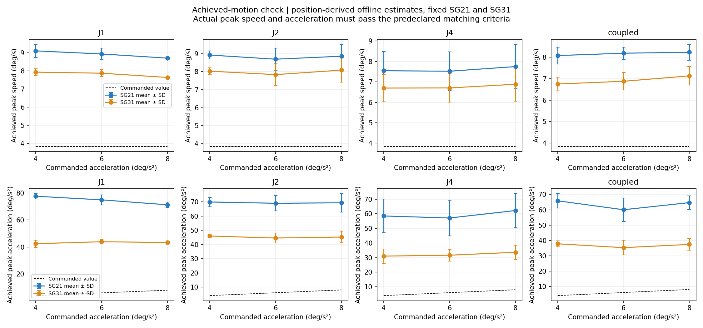
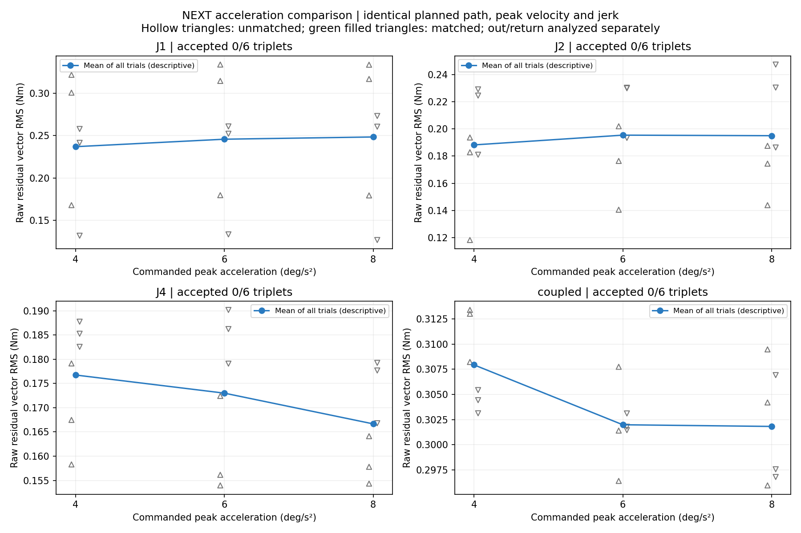
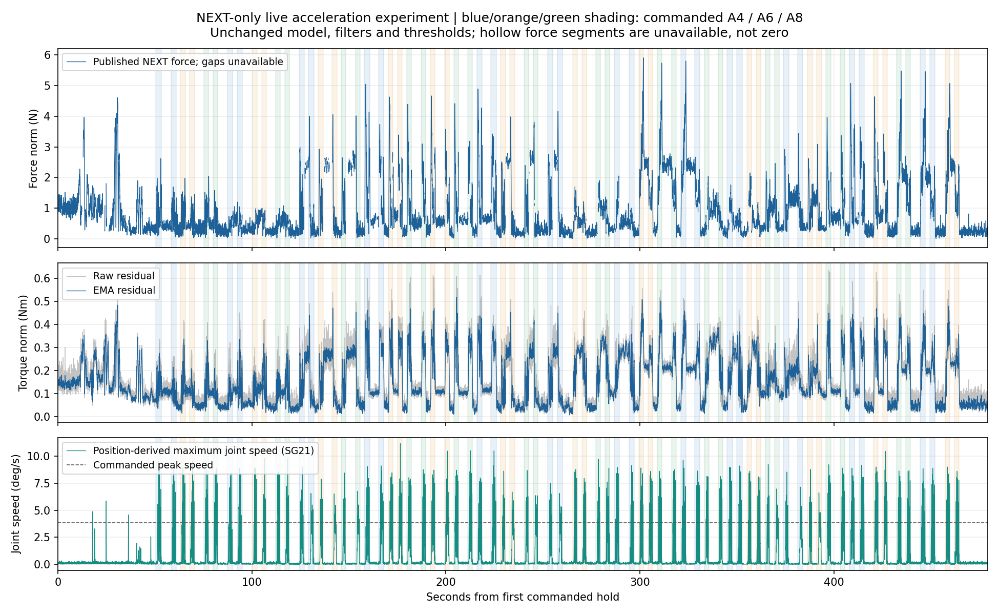

# 原版NEXT同路径、同峰速、不同加速度真机试验

状态：completed；完成72/72段比较运动；记录49489帧，平均100.00 Hz。

实际运动匹配通过 0/24 个三档配对组。每组为同一路径、同一重复、同一方向的4/6/8°/s²三次运动。

## 预先冻结的设计

- 路径：J1正向、J2正向、J4负向，以及[J1,J2,J4]=[1,0.5,-0.5]比例联动；各方向最大行程6.144°。
- 峰值目标速度固定3.84°/s；峰值目标加速度4、6、8°/s²；峰值加加速度固定25°/s³。原生S曲线整段一次发送。
- 各路径各档3次往返，方向分开比较；条件顺序为[4,6,8]、[6,8,4]、[8,4,6]；端点停留2秒。首末各10秒静置。
- 实际峰值速度跨档最大/最小≤1.15；实际起止姿态跨档跨度≤0.3°；实际峰值加速度递增且高/低≥1.4。固定SG21和SG31两种位置求导均需通过。
- 第一段比较紧接探测，缺少标准两秒前置静置，因此该三档配对组另标记历史条件不一致，不作为匹配通过组。

位置求导仅为离线诊断，使用居中平滑，不能直接部署。实际峰值测量窗口包含命令结束后固定0.25秒的跟踪尾段；没有拟合时间偏移。没有调整模型、控制增益、外力滤波、接触门限或零点。SG21与SG31的峰值量级也存在差异，因此不能将位置推算峰值当作独立标定的真实加速度。

另以实际执行起止时间重建72段S曲线，原生位置目标与冻结轨迹的最大差约0.000143°；支持控制器确实接收并生成了不同加速度条件，未在该核对中拟合时间偏移。详见native_command_check.json。

## 实际匹配结果

| 未通过原因 | 组数（原因可重叠） |
| --- | ---: |
| prehistory_not_standardized | 1 |
| achieved_acceleration_not_separated_SG21 | 24 |
| achieved_acceleration_not_separated_SG31 | 24 |
| start_pose_span_over_0.3deg | 4 |
| actual_peak_speed_mismatch_SG21 | 2 |
| actual_peak_speed_mismatch_SG31 | 2 |
| end_pose_span_over_0.3deg | 2 |

## 残差的描述统计

以下为所有比较运动的单段原始关节残差向量RMS均值，包含未通过匹配的组；不能直接作为惯性因果结论。

| 路径 | A4残差 Nm | A6残差 Nm | A8残差 Nm |
| --- | ---: | ---: | ---: |
| J1 | 0.2369 | 0.2457 | 0.2483 |
| J2 | 0.1882 | 0.1954 | 0.1950 |
| J4 | 0.1767 | 0.1730 | 0.1667 |
| coupled | 0.3079 | 0.3020 | 0.3018 |

## 判断边界

本次没有三档组同时满足实际运动匹配条件，因此不能据此认定惯性是主要原因，也不能认定惯性没有影响。目标轨迹的单变量设计成立，但目前的位置反馈及两种固定求导方法均未能确认实际加速度形成稳定三档。应先核查反馈/求导不确定性及实际跟踪的间歇变化，再安排新的独立验证；不通过放宽判定标准制造结论。

完整试验逐段参数、实测峰速/加速度、起止姿态差、末端可用率及名义温度范围见analysis.json。CAN温度未作独立标定，交错顺序仅减轻时间漂移影响，不等于温度恒定。

## 全程曲线

空载、无接触依据操作者声明，无独立力传感器。末端未发布的区间不填零；关节残差统计覆盖全部已记录运动样本。此次数据不加入训练，不用于选延迟或补偿参数。

原始四流、CAN、控制参数及运动跟踪：/home/venom/factr2/data/quick_capture/right/20261016_231752_162269
