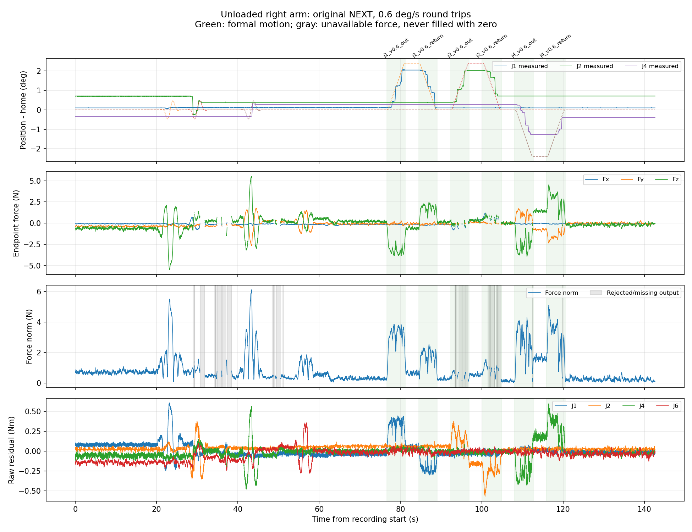

# 本次空载外力曲线观察

完成 22 段；14263 行 NEXT 同步记录。原版 NEXT，未扣除零偏、未拟合新时延。

|阶段|有效输出覆盖率|有效帧力范数 RMS (N)|有效帧力范数峰值 (N)|
|---|---:|---:|---:|
|初始静止最后8秒|100.0%|0.734|1.059|
|全部运动（含小幅验证）|84.3%|1.947|6.114|
|正式往返运动|82.3%|2.539|5.107|
|最终静止最后8秒|100.0%|0.271|0.696|

无接触来自操作者的空载说明，没有独立力传感器。末端力按现有滤波输出统计，拒绝或缺失帧留空；三阶段有效输出覆盖率不同，应结合覆盖率判断数值。

原始会话：/home/venom/factr2/data/quick_capture/right/20261019_225752_773614。逐段数据和拒绝原因见 observation.json；运动与跟踪审计见会话 audit/motion_run.json。
