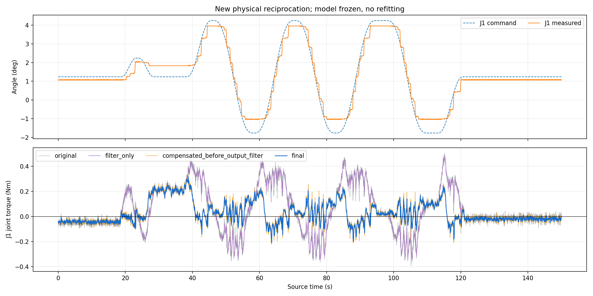
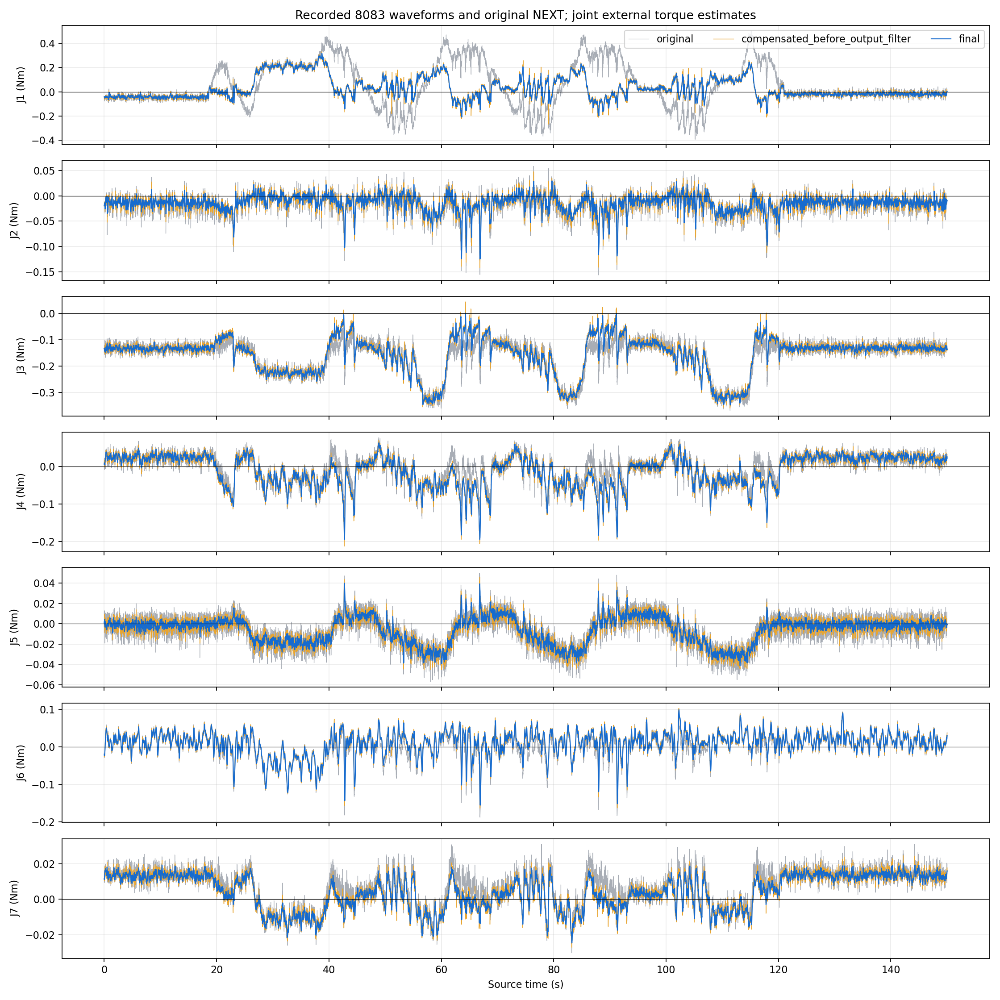
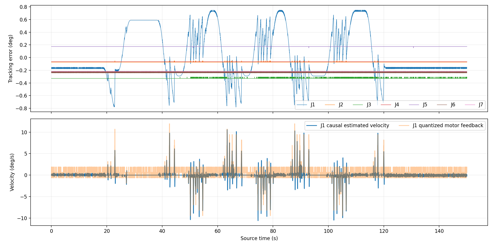

# 新一轮往复运动与 8083 波形记录

执行状态：**completed**；完成 12/12 段。

记录 15001 帧、150.02 秒，平均 99.99 Hz，最大源间隔 29.99 ms。原始/补偿后力矩恒等式最大误差 2.2e-16 N·m。

此次是模型部署后的新实机记录，模型、输入/输出滤波参数和控制增益保持冻结，没有用本次记录拟合或选择模型。现场声明为空载，无独立接触力矩传感器。

蓝线是实际发布到 8083 的最终输出，金色是补偿后输出滤波前，灰色是原 NEXT 残差；J1 图的紫线是使用同一滤波链但关闭学习补偿的离线对照。原始数据完整保留，不对曲线自动归零或裁剪。

运动段 7600 帧，补偿启用比例 99.96%。

|关节|原始 RMS Nm|仅滤波 RMS Nm|最终 RMS Nm|最终绝对峰值 Nm|
|---|---:|---:|---:|---:|
|J1|0.23876|0.23764|0.09764|0.31768|
|J2|0.02827|0.02574|0.02574|0.12465|
|J3|0.19071|0.19018|0.18127|0.34716|
|J4|0.04057|0.03879|0.05184|0.19410|
|J5|0.01832|0.01689|0.01689|0.04131|
|J6|0.03500|0.03355|0.03417|0.15557|
|J7|0.01031|0.00982|0.00811|0.02467|

J1 运动 RMS 改善 59.1%；实测角度范围 -1.035～3.970°，全程最大七轴跟踪误差 0.780°。

J1 电机速度反馈峰值 11.96°/s；它有量化且没有独立测速，2.4°/s 仅为规划上限。

单次同类轨迹不证明其他姿态和速度下泛化；仍存在的静止偏置也不能用曲线平滑掩盖。固定运动状态的合成阶跃 90% 延迟约 80 ms，不是新实机接触响应标定。

模型 SHA256：887d403a95a1a0fa1387232ae36e89bed368a0f9254a69a0d8a628d2502bed03

原始采集会话：/home/venom/factr2/data/quick_capture/right/20261023_193014_965189

原始样本 samples.csv、精确事件标签 labeled_samples.csv、同帧补偿包 distribution.jsonl、诊断 diagnostics.jsonl、冻结轨迹与模型归档 observer_archive 均保留；H5、bag、原始 CAN 与温度在上述采集会话中。
