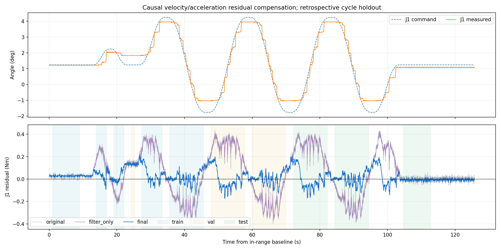
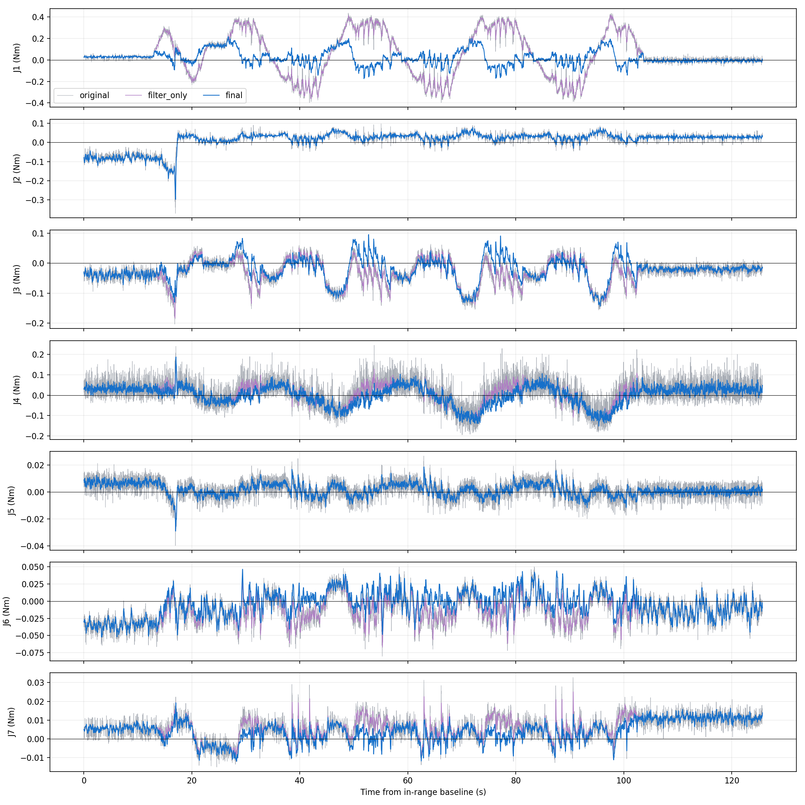

# 速度/加速度补偿与因果滤波：留出回放结果

这是原 NEXT 均值冻结后的附加观测分支；不改变机械臂控制器、增益、重力或摩擦前馈。没有执行新的机械臂运动。

历史数据保留原记录级 train/val/test。最新空载记录按第 1 次往复训练、第 2 次选择、第 3 次回顾性留出评估，边界两侧各排除 1 秒。训练还包含预先指定的静止前段和小幅试走，验证含试走后的停留，静止后段单独作为测试。测试轨迹以前已经看过，且三次往复相似，不能称为盲测或跨工况验证。

验证选中：velocity_acceleration，范围 local_pose，ridge=0.1。启用关节：J1, J3, J4, J6, J7；其余关节仅滤波。

以下只统计第 3 次往复的运动段（不混入静止段）。输入、样本、边界和原始模型完全相同。

|关节|原始 RMS Nm|仅滤波 RMS Nm|仅速度补偿＋滤波|速度/加速度补偿＋滤波|最终相对原始改善|
|---|---:|---:|---:|---:|---:|
|J1|0.26338|0.26236|0.07365|0.07313|72.2%|
|J2|0.03246|0.03095|0.03095|0.03095|4.6%|
|J3|0.05166|0.05046|0.04256|0.04230|18.1%|
|J4|0.06584|0.05370|0.05374|0.05320|19.2%|
|J5|0.00633|0.00487|0.00487|0.00487|23.2%|
|J6|0.02341|0.02226|0.01519|0.01490|36.3%|
|J7|0.00804|0.00757|0.00422|0.00402|50.0%|

J1 相邻样本一阶差分 RMS 从 0.026827 降到 0.005300 N·m，降低 80.2%。它是曲线粗糙度指标，不是独立噪声真值。

独立统计的停止后静止段，J1 原始 RMS 0.01812，最终 RMS 0.01249 N·m。未使用静止后目标拟合补偿或在线调零。

速度/方向项贡献主要改善；加速度项总体额外改善很小，并不是每个关节都优于仅速度。不能从这次相关性拟合声称辨识出了真实转动惯量、真实摩擦力矩或电流误差。

选中的局部模型只覆盖当前姿态附近，尤其 J3≈−2.77°。旧验证/测试的姿态不符合该局部范围，补偿回退，补偿前后 RMS 相同；这只能说明回退有效，不能证明跨姿态泛化。新关节运动和更高速度需要独立采集与验证。

## 信号链和延迟

原 LSTM 继续使用训练时的原始 q、速度反馈和跟踪误差。新增支路对实际位置和指令位置使用位置观测的常加速度卡尔曼滤波，因果估计速度和加速度；电机速度反馈另做 8 Hz 低通供诊断，不把静止时半个量化码的反馈当成真实运动。

12 Hz 相同因果低通同时作用于实测力矩与原 NEXT 自由预测，随后减去离线学到的运动残差，最后进行 5 Hz 因果低通。无未来帧、filtfilt、居中差分或峰值裁剪；只对补偿量设置训练数据范围上限，不裁剪外力残差。

公式：r_final = H5[ H12(tau_measured) − H12(mu_NEXT) − c(filtered_motion) ]。c 没有力矩/残差输入，没有常数截距，不在线学习、不按静止标志归零。

固定运动状态的合成 0.3 N·m 阶跃验证：稳态增益 1.000000，达到 90% 约 80 ms，20 ms 时约保留 47.1% 幅值。短碰撞脉冲会被削弱；本结果不是完整 LSTM/接触链的物理延迟标定。

真实接触时运动状态也可能变化，本次固定状态注入不能证明所有接触均不被削弱。需要独立接触真值验证；新输出不接入控制、急停或碰撞保护。原 sigma 对补偿后残差不再有效，新窗口不提供该置信带。

## 实现与验证

训练中没有充分激励的特征列固定为零权重，不用于外推判据，避免未激励关节的编码抖动使补偿频繁开关。v1 保留为初版记录，v2 修正此训练可辨识性问题；两版都是回顾性研究，不把已查看的第 3 次往复包装成新盲测。

数值验证包括：因果性、速度估计的量化偏置隔离、成对力矩滤波一致性、持续外力阶跃、超范围回退、时间回退/断流重置、21,945 帧逐帧训练/实时实现一致性。隔离 ROS domain 199 验证传输和超时失效，并检查只有观测发布器。

新窗口：http://127.0.0.1:8083/ ，默认最终平滑输出，可勾选补偿前 NEXT 原始曲线与输出滤波前曲线。原始模型窗口 http://127.0.0.1:8082/ 保留。

逐关节数值与粗糙度：heldout_detail.json；候选、选择与历史验证：comparison.json；完整回放：replay.npz；模型与姿态范围：model.json。
