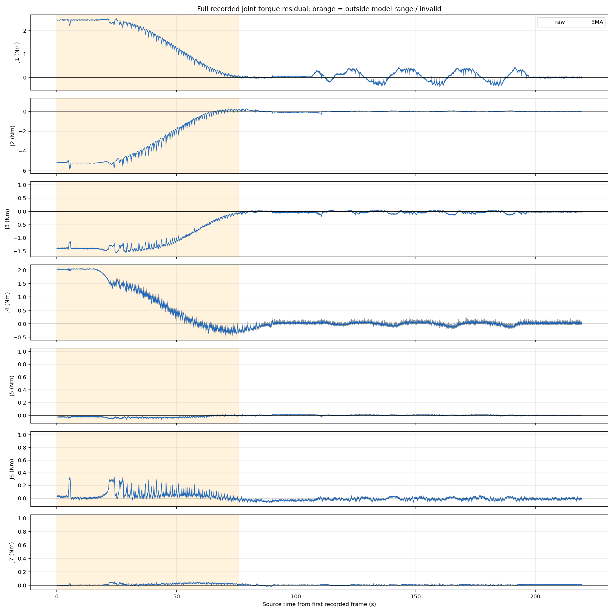
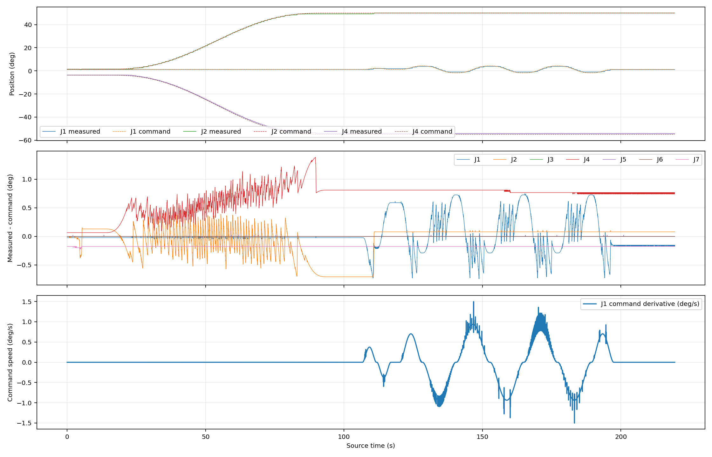
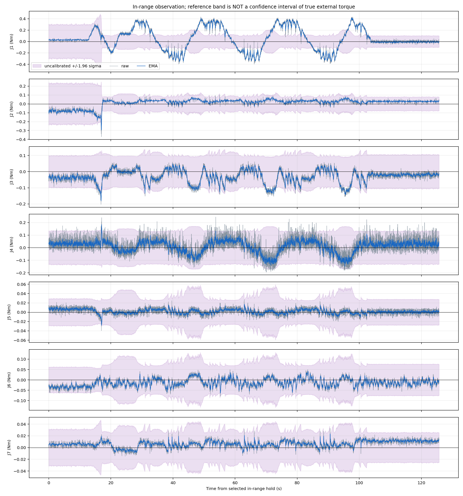
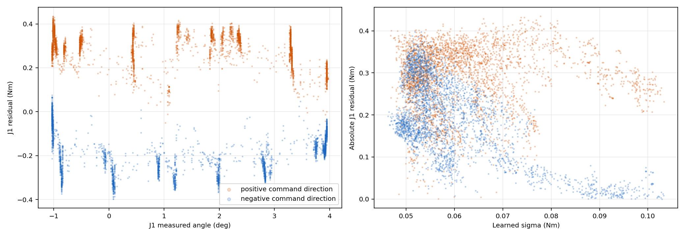

# 往复运动与关节外力矩观测

执行状态：**completed**；完成 14/14 段。

记录 21945 个同时间戳完整帧，跨度 219.45 秒，平均 100.00 Hz，最大源间隔 20.01 ms。原始残差与实测减预测的最大差 3.7e-09 N·m。

数据源：`/next/right/frozen_sigma`，与 8082 窗口一致；均值模型和 sigma 模型、增益、重力/摩擦前馈及系统时间同步设置保持固定。

起始姿态在训练范围外，缓慢就位段单独标记，不用它判断模型精度。空载来自操作者声明，没有独立力矩传感器；本文“残差”不等同于已经验证的真实接触力。

|关节|静止前均值 Nm|往复 RMS Nm|往复绝对 P95 Nm|往复绝对峰值 Nm|静止后均值 Nm|学习带覆盖率|固定带覆盖率|
|---|---:|---:|---:|---:|---:|---:|---:|
|J1|+0.0285|0.2422|0.3696|0.4347|-0.0078|25.2%|15.3%|
|J2|-0.0788|0.0348|0.0591|0.0974|+0.0284|99.9%|99.9%|
|J3|-0.0369|0.0567|0.1134|0.1558|-0.0220|89.3%|89.1%|
|J4|+0.0320|0.0656|0.1293|0.2442|+0.0260|97.7%|87.8%|
|J5|+0.0066|0.0062|0.0120|0.0268|+0.0002|100.0%|100.0%|
|J6|-0.0345|0.0229|0.0432|0.0801|-0.0180|100.0%|100.0%|
|J7|+0.0059|0.0080|0.0144|0.0327|+0.0115|99.8%|99.9%|

往复段七关节残差向量 RMS：原始 0.2609 N·m，EMA 0.2565 N·m。它是七轴统计量，不是末端力。

名义带覆盖率按“操作者声明空载、残差目标为零”计算，只是本次轨迹的校准诊断；不能替代真实外力置信区间，也不能验证电流或输出力矩的绝对准确性。匹配角度下的方向差及各段逐关节统计见 summary.json。

完整采集会话：/home/venom/factr2/data/quick_capture/right/20261023_152700_183710

原始同戳 CSV、全部 atomic distribution 包、健康/状态诊断、原始 CAN、电机温度、完整 bag、H5 和冻结轨迹均保留。本次是独立观测数据，不自动并入训练。

## 本次波形说明

1. J1 是本次动态残差的主要来源：RMS 0.2422 N·m，P95 0.3696 N·m，峰值 0.4347 N·m；相同计划速度档下，正向均值 +0.2901 N·m、反向均值 -0.1926 N·m。方向按指令位置导数划分，排除 |速度|≤0.1°/s 的端点区，不把电机量化速度当独立测速。
2. J1 的 EMA RMS 从 0.2422 降到 0.2411 N·m，仅降低 0.49%。低频/方向相关分量较明显，不能仅用高频电流噪声解释。优先复核摩擦方向与历史、速度量化、位置跟踪误差和训练覆盖；这次试验不能将它们的因果贡献分离。
3. 在 11 个同实际角度的 0.5° 分箱中，J1 正向减反向的均值差为 0.315～0.606 N·m。该方向差并非仅由两方向角度范围不同解释，但速度、加速度、跟踪及历史仍未严格配平。
4. J1 学习参考带覆盖 25.2%，固定带覆盖 15.3%；学习 σ 与绝对残差 Spearman 相关为 -0.233。这次动态误差被低估，σ 不能作为可靠的力矩置信度。J3 的覆盖也仅 89.3%。其他关节本次大部分静止，其较高覆盖率不能证明动态性能。
5. J2 静止前后均值由 -0.0788 变为 +0.0284 N·m。两段指令工作姿态相同，但实际角度、到位方向与内部历史有差别，不能直接归因于热漂移或已完成归零。

实测 J1 范围 -1.035～3.970°，指令范围 -1.762～4.238°；全程最大七轴跟踪误差 1.385°，未达到原有 3° 停止门限。三次往复完成后停在工作姿态，不额外自动回零。

模型计数增量：{'outputs': 21944, 'dropped': 0, 'resets': 0}；CAN 共 520311 帧，socket 丢帧 0，缺内核接收时间戳 0。H5 共同源区间对齐覆盖 99.99519%。温度为固件标称值，逐轴范围见 summary.json；没有独立电流、温度或力矩标定。

建议先用本次独立轨迹复核 J1 的正反向建模与速度反馈编码，再设计严格配对的低速摩擦/跟踪消融及外部已知力矩验证；本次不改增益、不自动归零、不用 σ 屏蔽残差，也不把本次记录并入训练。

6. J1 在往复段的电机速度反馈绝对峰值为 11.96°/s。2.4°/s 是规划上限，不能宣称实测速度也不超过它；低速量化及跟踪曲线中的周期性变化应一起复核。没有独立测速，本次不再提高速度或继续运动。

停止后独立只读复核：位置控制器与重力补偿控制器均 active、适配器正常且输入新鲜；实测 J2≈50.080°、J4≈−54.234°，指令为 50°/−55°。额外静止记录中各关节位置跨度最大约 0.022°。窗口截图为动作结束后保存，见 dashboard_after_motion.png。

启动阶段有两次预检失败，均未发送运动命令：首次为节点发现窗口过短，第二次为新 atomic 订阅尚未就绪；修正等待顺序后，本次 14 段实际执行一次完成。前两次日志保留于同级 v1/v2 目录；保护阈值未放宽。
