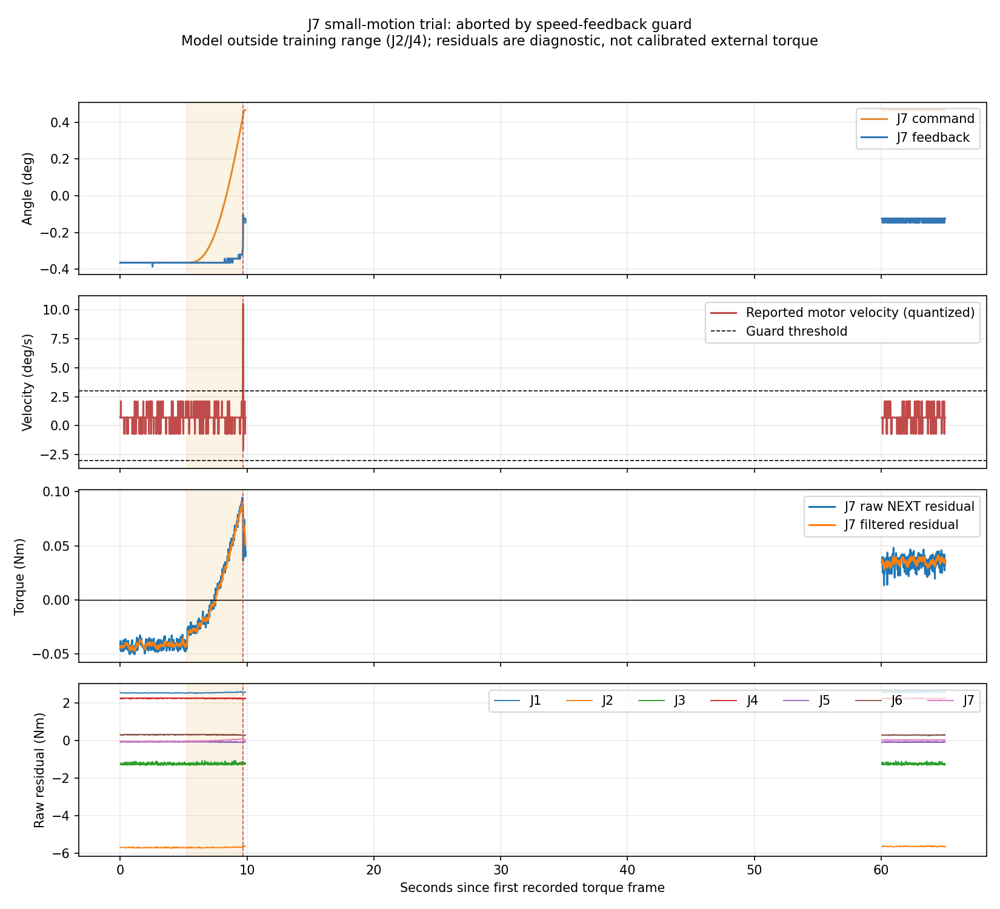

# J7 小幅运动与关节外力矩观察（2026-10-23）

操作者已确认空载、区域清空且急停可用。计划J7正向2°、10秒去程、3秒停留、10秒返回；规划峰速0.375°/s。

**实际结果：保护中止，未执行返回段。** 原因：J7 reported speed exceeded guard (quantized feedback)。已发送平滑制动请求；随后独立5秒观察确认位置稳定，重力与位置控制器均保持active。

J7最大实测角度变化约0.2624°；停止后相对起始均值偏移0.2348°，5秒位置跨度0.0219°。运动段电机速度反馈绝对峰值10.4938°/s；反馈存在量化，不作为独立速度标定。

|阶段|J7原始残差均值(Nm)|J7原始残差绝对峰值(Nm)|
|---|---:|---:|
|运动前|-0.041421|0.048320|
|去程及制动|+0.011306|0.094414|
|停止后|+0.035242|0.048050|

当前J2/J4接近零位，超出模型训练的约50°/-55°工作姿态。全部NEXT输出保留out_of_scope标记；上述数值是模型残差，不能据此推断真实环境接触力。J2等未运动关节也有数Nm残差，说明当前姿态下不适合判断力矩精度。

未自动重试、未放宽保护阈值、未执行额外回位。图中空白处为两次录制之间的未采样区间。

完整逐关节统计：summary.json；运动记录：samples.csv；停止后独立记录：post_stop_samples.csv；路径检查：collision.json；执行脚本：run.py。
