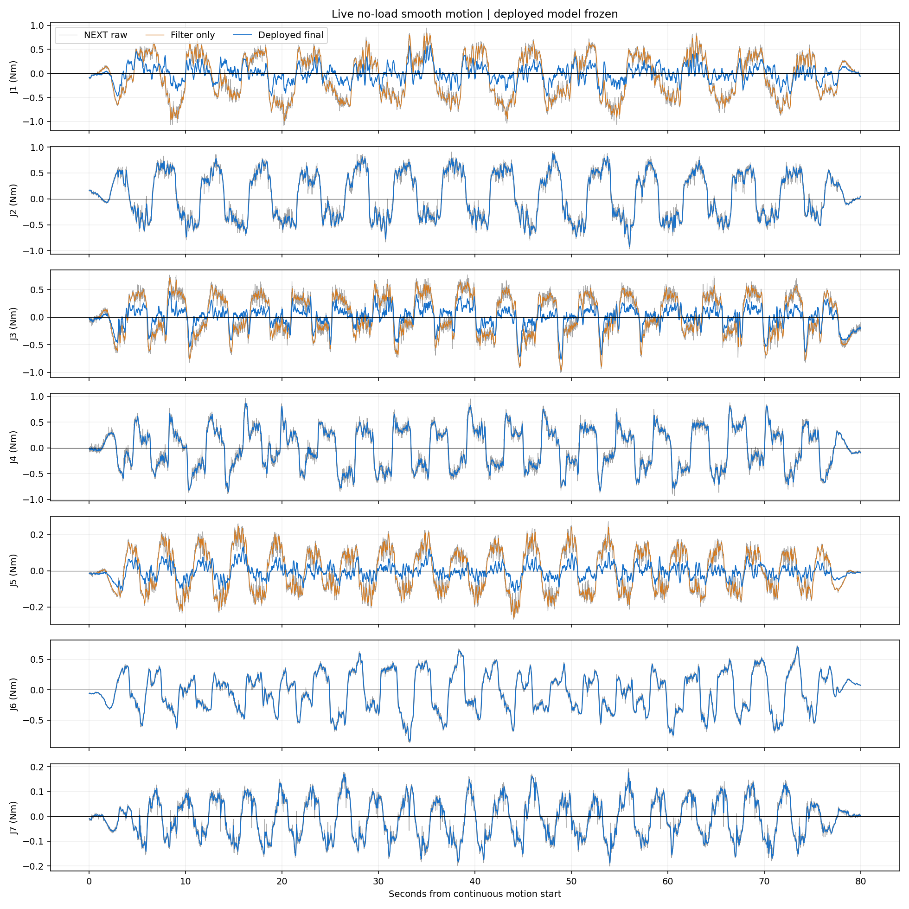
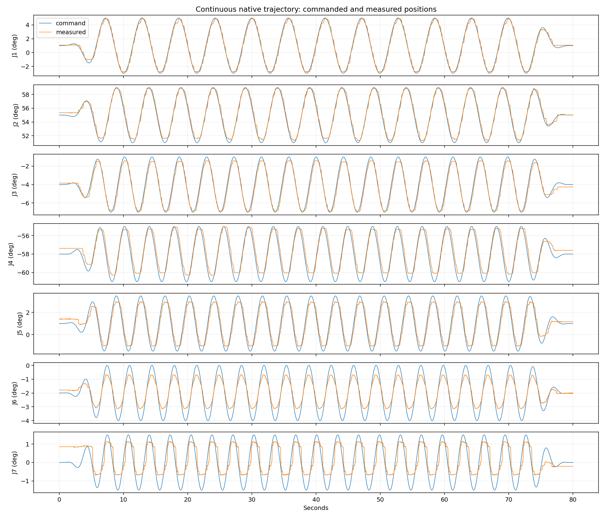

# 新模型实机平滑运动与波形记录（2026-10-26）

执行状态：completed；全程保持部署模型、增益和控制模式，未重新拟合参数。
正式段为80秒原生连续轨迹，首尾缓启动/缓停止，规划速度上限6°/s。下表统计中间64秒的空载关节力矩残差；没有独立外力矩传感器，不能当作真实接触测量精度。
共录制 26149 帧完整波形，最大源时间间隔 13.37 ms。CAN 丢帧 0，时间戳缺失 0。
正式评价段补偿支持率 100.00%；额外补偿仅对 J1/J3/J5 启用，其他关节的变化来自新均值与相同滤波。
滤波对照由同帧已滤波输入残差经相同5Hz输出滤波得到；用于区分平滑效果与学习补偿效果。所有记录保留完整精度，网页仍按两位小数显示。

|关节|NEXT原始RMS Nm|仅滤波RMS Nm|最终RMS Nm|最终均值 Nm|
|---|---:|---:|---:|---:|
|J1|0.46359|0.45734|0.16848|-0.00492|
|J2|0.46401|0.45845|0.45845|0.04276|
|J3|0.36153|0.35281|0.17705|0.00975|
|J4|0.40688|0.39969|0.39969|0.00044|
|J5|0.11928|0.11646|0.03819|-0.00327|
|J6|0.33053|0.32706|0.32706|-0.06294|
|J7|0.08404|0.08230|0.08230|-0.01013|

连续段最大跟踪误差 1.127°；位置变化筛查的整臂停顿最长 0.00 秒。单关节疑似滞停见 summary.json；换向和编码器量化也会影响该筛查。
先前独立测试中旧低速回归仍保留，本次观察不能替代跨速度、跨姿态和真实接触验证。

原始录制目录：/home/venom/factr2/data/quick_capture/right/20261026_142332_550227
完整数据：/home/venom/factr2/log/smooth_newmodel_observation_20261026_v1/samples.csv

