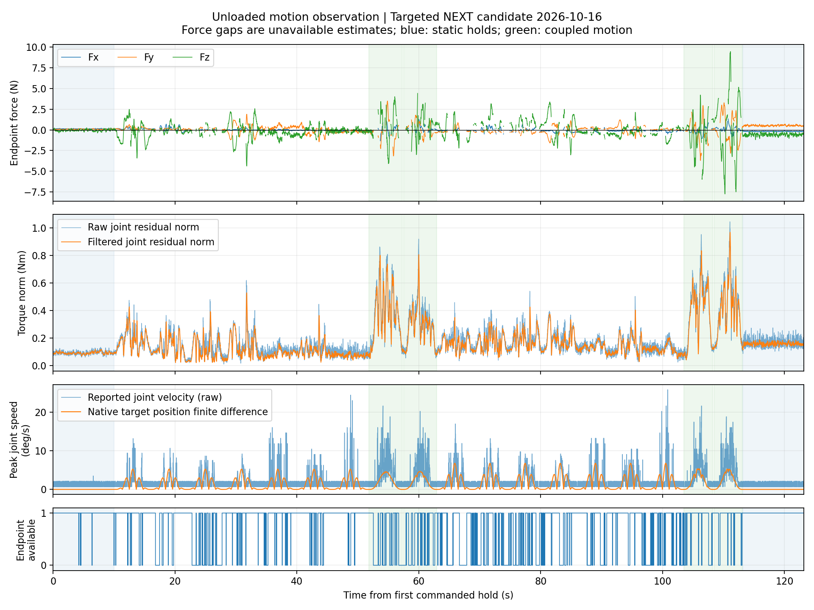

# 空载运动外力反馈观测

执行状态：completed；完成 20/20 个实验块。计划命令时间 119.37 秒，同步反馈 13310 帧。

速度档位 6、10°/s 是限制值，原生目标和实际反馈速度见 analysis.json，不能将限制值当作达到的速度。静止统计取首末 10 秒静置的最后 5 秒。

| 条件 | 有效末端比例 | 等效力模长均值 N | P95 N | 峰值 N |
| --- | ---: | ---: | ---: | ---: |
| 运动前静止 | 98.6% | 0.191 | 0.305 | 0.421 |
| 运动 | 70.3% | 1.117 | 3.507 | 9.833 |
| 运动后静止 | 100.0% | 0.796 | 1.015 | 1.260 |

假设沿用操作者此前的空载、无接触声明，没有独立力传感器。数值是模型估计的等效末端负载，不能作为真实接触力精度认证。无效末端样本计入可用率与拒绝原因，不填零。此次数据用于观察，不加入训练；保持模型、滤波、门限和归一化不变。

模型 SHA256：b5216350f2c76a7462ab931e5d62e8f2442e00e65f0f4146fb4b7868829d62a6

完整原始四流、运动跟踪、CAN 与控制审计：/home/venom/factr2/data/quick_capture/right/20261016_211956_613895

原生目标速度峰值：低档 5.25°/s，高档 6.78°/s。速度反馈包含尖峰，曲线另列原生目标位置差分作对照；不将速度反馈尖峰直接解释为实际运动速度。

运动后原生目标与开始时相同，但实际静止姿态存在差异，最大均值变化约 1.232°。因此基线变化不能全部归因于同一实际姿态下的摩擦历史。

运动样本的关节推理持续有效；末端拒绝原因见表对应的 analysis.json，均为 inconsistent_with_tool_contact。末端力统计仅覆盖有效发布样本，不能代表被拒绝时段的力幅值。
