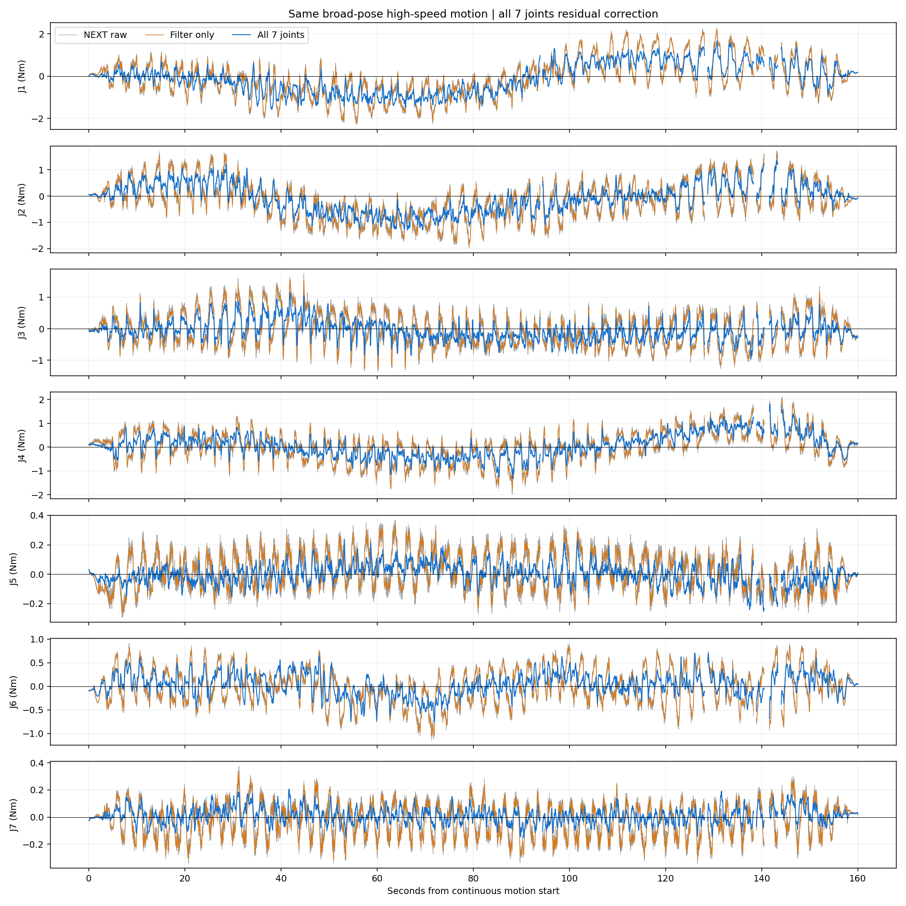
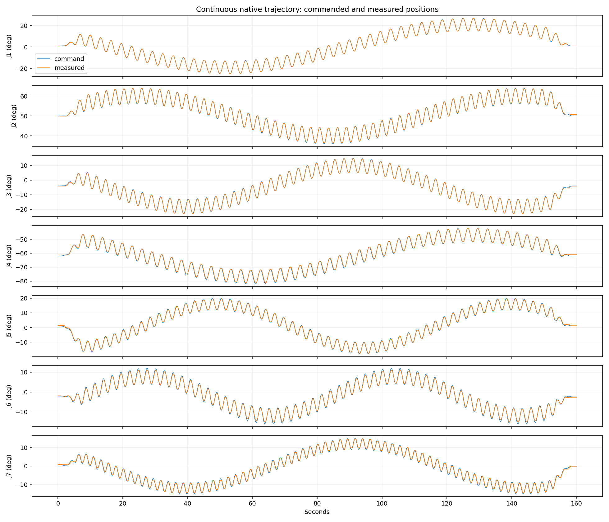

# 七关节全部启用补偿：同轨迹运动与波形记录（2026-10-26）

执行状态：completed；全程保持部署模型、增益和控制模式，未重新拟合参数。
完全复用上次轨迹，正式段为160秒连续运动、速度上限18°/s；下表统计中间140秒且状态有效的空载残差。NEXT均值不变，按用户明确要求启用J1–J7全部残差补偿；原验证只选择J1/J3/J5，本次覆盖启用掩码属于预先声明的研究对照。系数、滤波、限幅和特征/姿态适用范围不变，未使用本次观察重新拟合。没有独立力矩传感器，不能当作真实接触精度。
共录制 33294 帧完整波形，最大源时间间隔 13.35 ms。CAN 丢帧 0，时间戳缺失 0。
正式评价段补偿支持率 100.00%；J1–J7均启用额外补偿，适用范围之外仍保留回退及状态标记。
滤波对照由同帧已滤波输入残差经相同5Hz输出滤波得到；用于区分平滑效果与学习补偿效果。所有记录保留完整精度，网页仍按两位小数显示。

|关节|NEXT原始RMS Nm|仅滤波RMS Nm|最终RMS Nm|最终均值 Nm|
|---|---:|---:|---:|---:|
|J1|0.91047|0.90284|0.74668|-0.11568|
|J2|0.76722|0.75830|0.57420|-0.11047|
|J3|0.53948|0.52788|0.32912|-0.05567|
|J4|0.64976|0.64128|0.50277|0.07574|
|J5|0.12769|0.12254|0.06897|0.00233|
|J6|0.37706|0.37165|0.23987|0.03299|
|J7|0.13105|0.12701|0.05907|0.01105|

连续段最大跟踪误差 1.300°；位置变化筛查的整臂停顿最长 0.00 秒。单关节疑似滞停见 summary.json；换向和编码器量化也会影响该筛查。
已有保留测试集的全关节版本低速回归未通过：相同滤波下RMS约0.07725→0.09630 N·m；高速约0.51941→0.39094 N·m。该测试集已用于前版本评价，不能视作全新的盲测。本次按用户要求仅作只读补偿观察，未根据测试继续调参或重新选择启用掩码。补偿未进入电机命令，deployment_ready=false。

原始录制目录：/home/venom/factr2/data/quick_capture/right/20261026_163855_543048
完整数据：/home/venom/factr2/log/wide_all_joint_compensated_observation_20261026_v2/samples.csv

相同输入及相同滤波下整体RMS：0.56686→0.43328 N·m，新增补偿降幅23.57%。
正式连续段最大数据间隔13.35ms；越出学习范围时补偿回退且保留状态标记，不强制调零。
全部运动停止后恢复自动校时：sudo systemctl start systemd-timesyncd。

同一批输入上还重放了原J1/J3/J5启用方式，滤波完全相同，便于隔离新启用四轴的作用（该重放不是另一次实机运动）：

|关节|仅滤波RMS Nm|原三轴补偿重放RMS Nm|七轴补偿RMS Nm|补偿量RMS Nm|
|---|---:|---:|---:|---:|
|J1|0.90284|0.74668|0.74668|0.48545|
|J2|0.75830|0.75830|0.57420|0.40987|
|J3|0.52788|0.32912|0.32912|0.34138|
|J4|0.64128|0.64128|0.50277|0.34865|
|J5|0.12254|0.06897|0.06897|0.10915|
|J6|0.37165|0.37165|0.23987|0.29283|
|J7|0.12701|0.12701|0.05907|0.11928|

原三轴同输入重放整体RMS 0.50866 N·m；七轴版本 0.43328 N·m。输出因果滤波重放误差 0 N·m。
状态有效帧占正式评价段 97.43%；越界帧保留但不纳入表格。

运动后8秒只读核查通过：硬件健康，无运动发布者，最大静止位置跨度0.02186°；检测包年龄3.83ms。七轴启用掩码、每轴实际非零补偿和原始限幅已逐包审核；基础模型及权重/滤波/支持域哈希未改变。

首次启动拦截及只读服务超时、就绪检查修复详见PROTOCOL.md；21项回归测试通过。原始中止记录保留，完整运动采用新独立录制目录。
