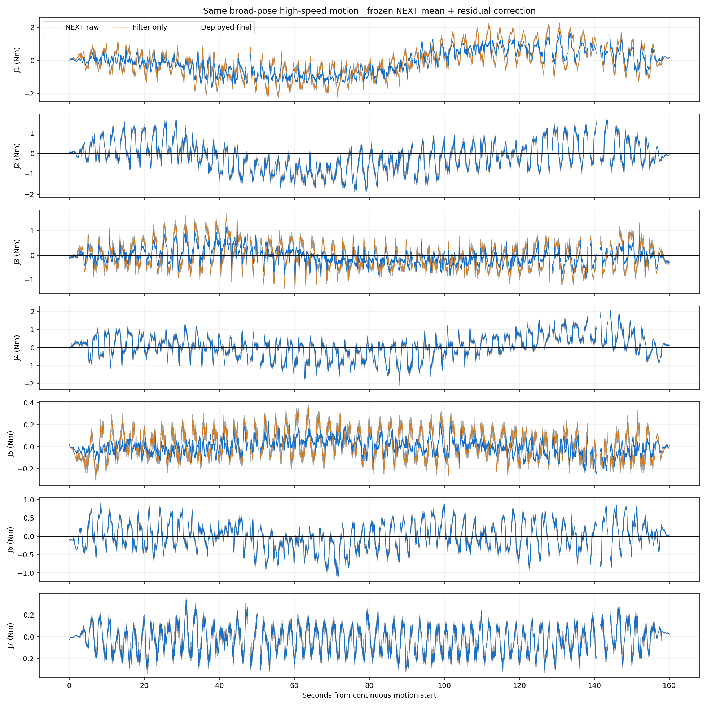
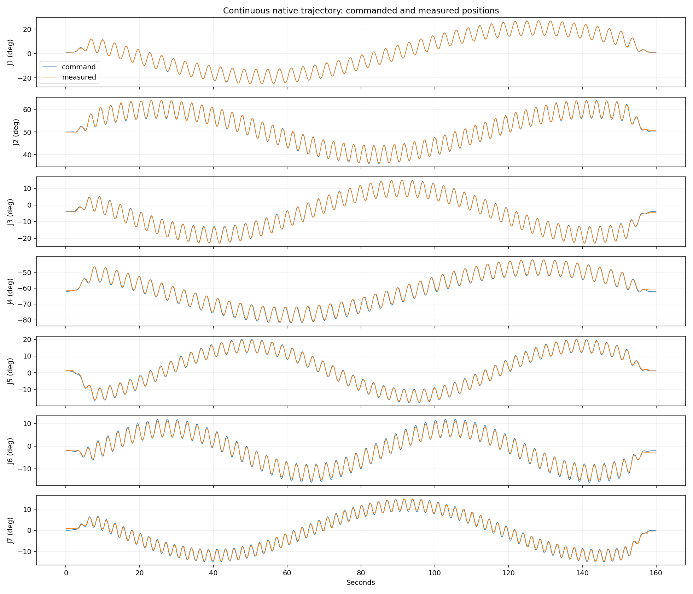

# 新模型实机平滑运动与波形记录（2026-10-26）

执行状态：completed；全程保持部署模型、增益和控制模式，未重新拟合参数。
完全复用上次轨迹，正式段为160秒连续运动、速度上限18°/s；下表统计中间140秒且状态有效的空载残差。NEXT均值不变，仅新增J1/J3/J5残差补偿；未使用本次观察重新拟合。没有独立力矩传感器，不能当作真实接触精度。
共录制 33228 帧完整波形，最大源时间间隔 13.37 ms。CAN 丢帧 0，时间戳缺失 0。
正式评价段补偿支持率 100.00%；额外补偿仅对 J1/J3/J5 启用，其他关节的变化来自新均值与相同滤波。
滤波对照由同帧已滤波输入残差经相同5Hz输出滤波得到；用于区分平滑效果与学习补偿效果。所有记录保留完整精度，网页仍按两位小数显示。

|关节|NEXT原始RMS Nm|仅滤波RMS Nm|最终RMS Nm|最终均值 Nm|
|---|---:|---:|---:|---:|
|J1|0.91194|0.90404|0.74692|-0.10446|
|J2|0.76674|0.75828|0.75828|-0.19005|
|J3|0.53762|0.52608|0.33022|-0.05454|
|J4|0.64739|0.63885|0.63885|0.03771|
|J5|0.12828|0.12310|0.06887|0.00167|
|J6|0.37420|0.36885|0.36885|-0.01104|
|J7|0.13122|0.12719|0.12719|-0.02905|

连续段最大跟踪误差 1.344°；位置变化筛查的整臂停顿最长 0.00 秒。单关节疑似滞停见 summary.json；换向和编码器量化也会影响该筛查。
独立低速回归未通过：相同滤波下RMS约0.07725→0.08608 N·m；高速约0.51941→0.47599 N·m。本次按用户要求仅作只读补偿观察，未改变阈值或根据测试继续调参。

原始录制目录：/home/venom/factr2/data/quick_capture/right/20261026_161106_342236
完整数据：/home/venom/factr2/log/wide_compensated_observation_20261026_v1/samples.csv

相同输入及相同滤波下整体RMS：0.56626→0.50808 N·m，新增补偿降幅10.27%。
正式连续段最大数据间隔13.36ms；越出学习范围时补偿回退且保留状态标记，不强制调零。
全部运动停止后恢复自动校时：sudo systemctl start systemd-timesyncd。

评价区间状态有效率为96.74%，超域帧保留原始数据和标记、未强制归零、不纳入有效区间RMS。补偿在有效评价帧中100%处于支持范围；J2/J4/J6/J7的补偿向量全程严格为零，其最终输出与相同滤波对照逐点一致。

输入预测力矩由尽力传输改为发布端已支持的可靠传输；同帧数值算法不变。接收调度抖动与源采样间隔分开记录，仍保留40ms源间隔和250ms新鲜度限制。初次检查结果及逐帧追踪均完整保留。
