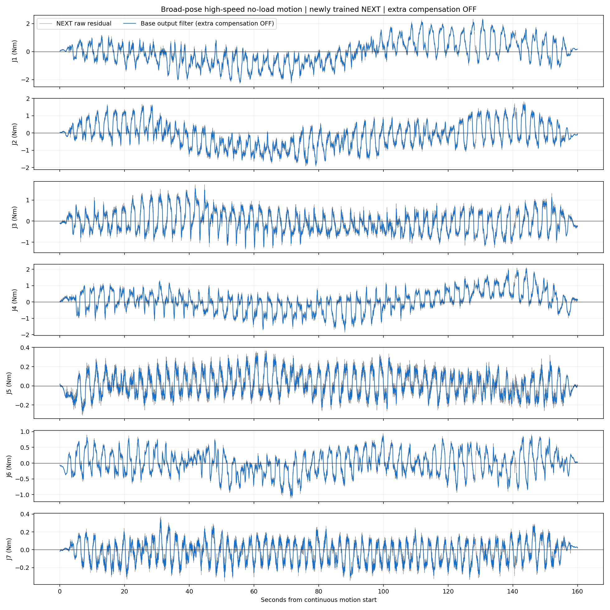
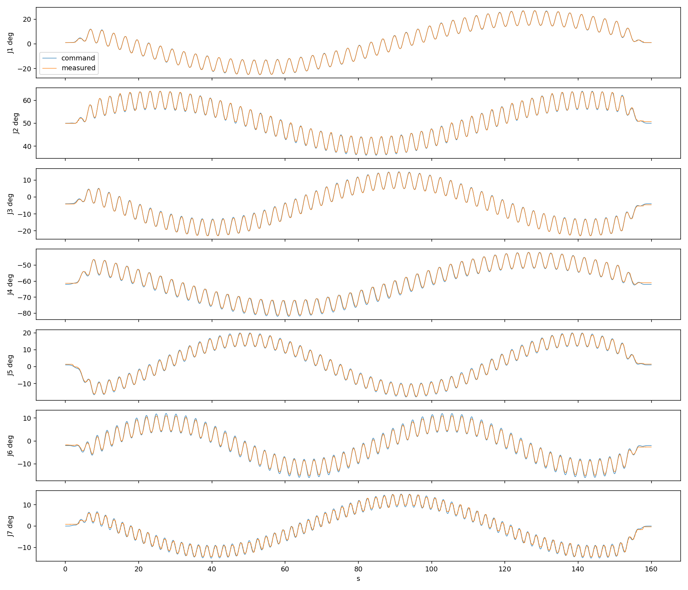

# 大范围高速采集、重新训练与无额外补偿复测

本轮三次独立空载记录新增 12/18°/s 上限的连续高速运动，低频大范围姿态扫描与高速载波叠加。历史低速与既有高速数据沿用，原始会话角色不变。单 seed 0、最多20轮、有旧模型保持项的全模型微调；验证集选模后读取独立测试。
部署前已停止额外速度/加速度残差补偿，旧补偿话题发布器为零；新均值和匹配 sigma 只作观测，不进入电机控制。原始外力矩为实测减预测，最终曲线保留基础输出滤波。以下检查确认整次补偿向量严格为零。
实机复测完成，录制 32155 帧；连续段 160.0 秒，中间段状态有效率 99.09%。CAN 零丢帧、零时间戳缺失。

|关节|原始残差 RMS N·m|基础滤波 RMS N·m|滤波均值 N·m|最大跟踪误差 °|
|---|---:|---:|---:|---:|
|J1|0.9078|0.8976|-0.0878|0.623|
|J2|0.7660|0.7553|-0.1843|0.754|
|J3|0.5382|0.5230|-0.0394|0.864|
|J4|0.6651|0.6538|0.0562|1.304|
|J5|0.1278|0.1219|0.0297|0.892|
|J6|0.3797|0.3719|-0.0114|1.081|
|J7|0.1305|0.1256|-0.0290|1.165|

独立测试性能检查：
```json
{
  "passed": true,
  "criteria": {
    "scope": "Read-only external joint torque observation; never motor feedforward",
    "minimum_new_highspeed_test_mse_improvement_fraction": 0.05,
    "maximum_old_test_mse_ratio": 1.15,
    "minimum_final_highspeed_test_mse_improvement_fraction": 0.05,
    "maximum_final_old_test_mse_ratio": 1.15,
    "minimum_highspeed_test_position_support_fraction": 0.98,
    "per_joint_rmse_allowance": "no increase greater than max(20% incumbent RMSE, 0.02 Nm)",
    "require_completed_independent_recordings": true,
    "require_clean_CAN": true,
    "test_fail_action": "Keep incumbent; freeze failed candidate and do not tune on this test recording",
    "real_contact_validation": false
  },
  "per_joint_pass": {
    "old": [
      true,
      true,
      true,
      true,
      true,
      true,
      true
    ],
    "high": [
      true,
      true,
      true,
      true,
      true,
      true,
      true
    ]
  },
  "highspeed_mse_ratio": 0.6192114593985265,
  "old_mse_ratio": 1.0055556623404223,
  "action": "Candidate may proceed to matched-head and compensation checks"
}
```
本次路径范围和速度与上次实机观察不同，不能直接用两张不同轨迹的波形证明模型进步；应优先看本轮相同独立测试数据上的模型前后对照。空载残差也不是有独立力矩传感器验证的真实接触精度。sigma 未经独立校准。





完整精度数据：/home/venom/factr2/log/wide_highspeed_20261026_v2_clockstable/plans/observation/samples.csv
原始采集：/home/venom/factr2/data/quick_capture/right/20261026_153925_852649

同一独立测试输入的新旧模型比较：/home/venom/factr2/log/wide_highspeed_20261026_v2_clockstable/heldout_mean_comparison/REPORT.md
采集中曾发生一次约500ms的系统实时时钟跳变；CAN单调时间连续。中断验证记录已排除，现场用户暂停自动校时后，90秒静止检查通过并完整重录验证/测试。全部运动结束后需恢复校时：sudo systemctl start systemd-timesyncd。

正式连续段最大源时间间隔 13.39ms；全录制最大583ms间隔发生在运动前启动/模型预热阶段。统计只采用连续段中间且状态有效的帧，约0.91%的中间段帧标记为超出训练姿态范围，原始值保留且不归零，未用于表中RMS。
