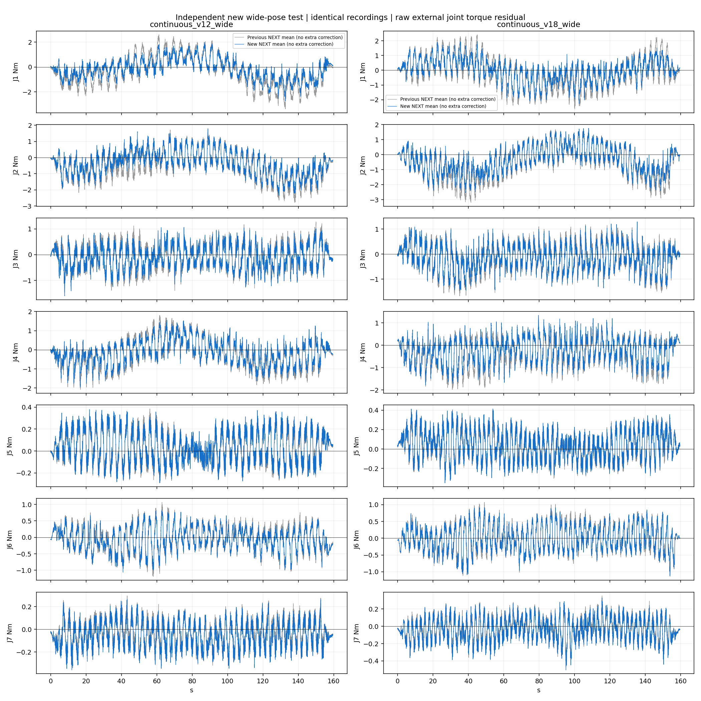

# 同一独立测试记录上的新旧模型比较

全部关闭额外速度/加速度补偿，使用完整精度原始残差；两模型使用完全相同的独立测试输入，不把不同实机轨迹的波形直接相互比较。

|测试范围|旧模型整体 RMS N·m|新模型整体 RMS N·m|RMS 降幅|
|---|---:|---:|---:|
|historical_low|0.08192|0.08215|-0.28%|
|previous_high|0.46093|0.38646|16.16%|
|new_wide_high|0.71327|0.55681|21.94%|

本表为本轮选模结束后的独立评价，不用于继续调整本轮模型。空载残差不是有独立传感器验证的真实接触精度。

